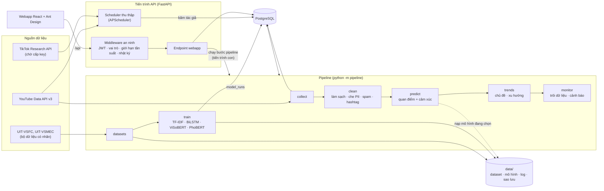
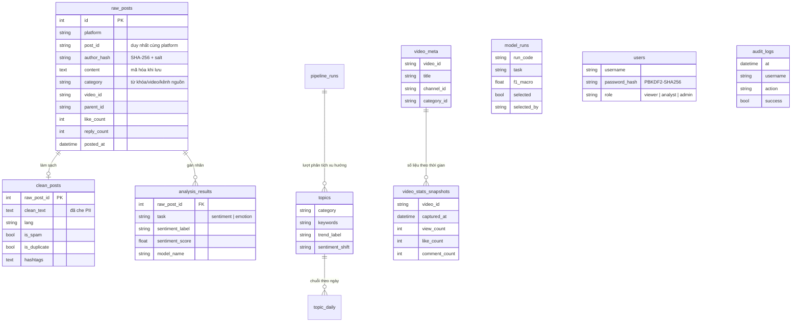

# Tổng quan hệ thống thu thập và phân tích cảm xúc, xu hướng mạng xã hội

Tài liệu duy nhất mô tả **ý tưởng, thiết kế và cách ứng dụng** hệ thống. Lịch sử sửa đổi nằm ở [LICH_SU_CHINH_SUA.md](LICH_SU_CHINH_SUA.md). Hướng dẫn riêng cho Claude nằm ở [CLAUDE.md](CLAUDE.md).

---

## 1. Ý tưởng

### 1.1. Đề tài

*Nghiên cứu các kỹ thuật máy học hiện đại kết hợp đảm bảo an ninh an toàn ứng dụng trong phát triển thử nghiệm hệ thống thông tin hỗ trợ thu thập, lưu trữ tự động dữ liệu mạng xã hội để nhận diện và phân loại cảm xúc và xu hướng của người dùng.*

Đề tài KH-CN cấp trường, Trường ĐH Điện lực, Khoa Điện toán và Công nghệ số năng lượng. Nhóm thực hiện trên repo: **Nam** và **Lâm**. GV hướng dẫn: ThS. Lê Thanh Trà.

### 1.2. Bài toán

Người Việt bày tỏ rất nhiều cảm xúc và quan điểm trên mạng xã hội. Doanh nghiệp, cơ quan quản lý cần biết **dư luận đang tích cực hay tiêu cực** và **chủ đề nào đang nổi lên**, nhưng đọc thủ công thì không xuể. Hệ thống làm bốn việc:

1. **Thu thập, lưu trữ tự động** bình luận công khai, liên tục.
2. **Nhận diện và phân loại cảm xúc**: tích cực / trung tính / tiêu cực, và cảm xúc cụ thể (vui, buồn, giận, sợ, ghê tởm, ngạc nhiên).
3. **Phát hiện và phân loại xu hướng**: chủ đề nào đang nổi, tăng hay giảm, cảm xúc về chủ đề đó đổi ra sao.
4. **Bảo đảm an ninh an toàn** cho cả hệ thống (bảo mật, phân quyền) lẫn quá trình học máy (ẩn danh, học máy bảo toàn quyền riêng tư, chống tấn công mô hình).

Trọng tâm nghiên cứu là **kỹ thuật máy học hiện đại kết hợp an ninh an toàn**. Hệ thống thông tin là nơi thử nghiệm các kỹ thuật đó. Điểm mới là gộp thu thập, cảm xúc, xu hướng và an ninh thành một hệ thống liền mạch cho tiếng Việt thay vì làm rời từng phần.

Khó khăn riêng của tiếng Việt trên mạng: teencode, viết tắt, không dấu, emoji, trộn tiếng Anh, nói mỉa.

### 1.3. Mục tiêu và câu hỏi nghiên cứu

| Mục tiêu | Nội dung | Câu hỏi nghiên cứu |
|---|---|---|
| MT1 | Tổng quan, chọn phương pháp | |
| MT2 | Thu thập và lưu trữ tự động | CH3: kiến trúc nào chạy ổn định, mở rộng được? |
| MT3 | Nhận diện, phân loại cảm xúc | CH1: mô hình nào tốt nhất cho tiếng Việt mạng xã hội? |
| MT4 | Phát hiện, phân loại xu hướng | CH2: phát hiện xu hướng theo thời gian thế nào? |
| MT5 | An ninh, an toàn, tuân thủ luật | CH4: bảo vệ dữ liệu mà vẫn giữ được độ chính xác? |
| MT6 | Hệ thống tích hợp và dashboard | CH5: ghép được cả 4 phần không? |
| MT7 | Đánh giá thực nghiệm, đề xuất | |

Sản phẩm đầu ra: phần mềm prototype, bộ dữ liệu (thô, đã làm sạch, đã gán nhãn, train/validation/test), bảng so sánh mô hình, báo cáo tổng kết. Bài báo chưa cam kết.

### 1.4. Quyết định đã chốt

Những quyết định này định hình toàn bộ thiết kế. Thay đổi chúng phải ghi vào [LICH_SU_CHINH_SUA.md](LICH_SU_CHINH_SUA.md).

| Quyết định | Nội dung | Lý do |
|---|---|---|
| Thu thập qua API chính thức | YouTube Data API v3, TikTok Research API. Không cào HTML | Tuân thủ điều khoản nền tảng và pháp luật |
| Băm tác giả khi thu thập | SHA-256 + salt, không lưu tên hay ID gốc | Luật Bảo vệ dữ liệu cá nhân 91/2025/QH15 |
| PostgreSQL là kho dữ liệu chính | Các bước pipeline trao đổi qua DB | Đơn giản, đủ cho quy mô quota YouTube |
| Cảm xúc hai tầng | Quan điểm 3 lớp (cho dashboard) và cảm xúc 7 nhãn theo UIT-VSMEC (để so sánh mô hình) | Tên đề tài yêu cầu "cảm xúc"; thuyết minh gốc chỉ có 3 lớp |
| "Xu hướng của người dùng" là xu hướng chủ đề của cộng đồng | Không lập hồ sơ từng người, không gom theo `author_hash` | Khớp thuyết minh, tránh rủi ro pháp lý |
| Differential privacy nằm trong phạm vi | Học liên kết (federated) chỉ mô phỏng, tùy chọn | Trả lời CH4, vừa sức hai người |
| Phân quyền 3 vai trò | Người xem, phân tích viên, quản trị. Phân tích viên chỉ xem văn bản đã che dữ liệu cá nhân | Bảo vệ người bình luận |
| Mô hình chính | Transformer tiếng Việt (PhoBERT-base-v2, ViSoBERT); mô hình đang dùng là mô hình có F1-macro cao nhất, quản trị có thể chọn tay | Kết quả thực nghiệm (mục 5) |
| Chủ đề bản đầu | TF-IDF + NMF theo chủ đề thu thập; xu hướng theo luật 3 ngày so với 7 ngày | BERTopic cần umap/hdbscan chưa có bản cho Python 3.14; luật đơn giản, dễ giải thích, làm mốc so sánh |
| Một bộ tiền xử lý cho dữ liệu vào mô hình | `preprocessing/text.py` (cả dữ liệu huấn luyện lẫn dữ liệu thu thập). Bộ `cleaner/pipeline/tokenizer` của Lâm chưa được pipeline dùng | Đổi bộ làm sạch thì mọi mô hình phải huấn luyện lại. Chờ Nam và Lâm chốt việc hợp nhất |

---

## 2. Thiết kế

### 2.1. Thành phần và luồng dữ liệu



| Thành phần | Mã nguồn | Ghi chú |
|---|---|---|
| Thu thập | `collector/` | API chính thức; băm tác giả trước khi ghi DB. Chi tiết ở mục 2.2 |
| Làm sạch | `preprocessing/text.py` | Unicode NFC, dấu thanh, teencode, emoji, che SĐT/email/@tên, spam, ngôn ngữ, hashtag. Đổi bộ này phải tăng `PIPELINE_VERSION` |
| Dataset | `pipeline/datasets.py` | Tải UIT-VSFC/UIT-VSMEC, làm sạch bằng cùng hàm, kiểm tra rò rỉ train↔test |
| Huấn luyện, đánh giá | `models/sentiment/train.py` | Mỗi lần chạy ghi `model_runs` và thư mục `data/models/<mã>` |
| Dự đoán | `models/sentiment/predict.py` | Dùng mô hình đang được chọn |
| Xu hướng | `models/trend/trends.py` | TF-IDF + NMF theo chủ đề; luật xu hướng |
| Điều phối | `pipeline/` | Mỗi bước ghi `pipeline_runs` (thời gian, số bản ghi vào/ra, lỗi) |
| API và an ninh | `api/`, `security/` | Mọi route cần đăng nhập trừ `/health`; route chưa khai báo mặc định chỉ quản trị |
| Webapp | `frontend/` | React 19 + Ant Design 5 + recharts + Vite |
| Thực nghiệm | `experiments/` | Kết quả ở `data/experiments/*.json`, hiển thị ở mục Mô hình |

Hàng đợi (Kafka/RabbitMQ) trong kiến trúc mục tiêu **chưa có**: các bước trao đổi qua PostgreSQL, mỗi bước chỉ xử lý bản ghi chưa xử lý nên chạy lại không bị trùng. Pipeline chạy theo lượt (batch), chưa xử lý luồng thời gian thực.

### 2.2. Thu thập

`<nền tảng>_client.iter_*()` (httpx, duyệt trang) → `_parse_*_comment()` (chuẩn hóa) → `_ingest()` (băm tác giả, ghi `raw_posts`, bỏ qua trùng `(platform, post_id)`). Lỗi ở một video không làm hỏng cả lượt.

**Nguồn video của mỗi lượt định kỳ** (scheduler đọc cấu hình từ DB mỗi lượt, đổi qua giao diện có hiệu lực ngay):

| Nguồn | Chi phí quota | Cấu hình |
|---|---|---|
| Video theo dõi cố định (YouTube, TikTok) | ~1 unit/video | Giao diện: "Video theo dõi cố định" |
| Kênh theo dõi | ~2 unit + 1 unit/video | Giao diện: "Kênh theo dõi" (nhận `@handle`, URL kênh hoặc ID `UCxxxx`) |
| Video thịnh hành | 1 unit + ~1 unit/video | `.env`: `COLLECTOR_TRENDING_ENABLED`, `COLLECTOR_TRENDING_REGION`, `COLLECTOR_TRENDING_MAX_VIDEOS`; category = `trending` |
| Từ khóa tìm kiếm | **100 unit/từ khóa/lượt** | Giao diện: "Từ khóa tìm kiếm" |

Quota miễn phí của YouTube là 10.000 unit/ngày, nên ưu tiên kênh và video theo dõi, dùng từ khóa vừa phải.

**Chế độ tăng dần.** Bình luận được duyệt từ mới tới cũ. Lượt định kỳ dừng ngay khi gặp một trang không có bình luận mới, nên chỉ tốn khoảng 1 unit/video/lượt. Muốn lấy lại toàn bộ một video thì dùng CLI `python -m collector run`. Hạn chế: trả lời mới của bình luận cũ có thể bị bỏ sót ở chế độ này. Video có `commentCount = 0` được bỏ qua.

**Dữ liệu thu mỗi lượt** (phục vụ phân tích xu hướng):

- `raw_posts`: nội dung (mã hóa khi lưu), tác giả đã băm, `posted_at`, `category` (từ khóa hoặc ghi chú của nguồn), `video_id`, `parent_id` (rỗng là bình luận gốc, có giá trị là trả lời), `like_count`, `reply_count`. Trả lời được lấy kèm bình luận gốc (tắt bằng `COLLECTOR_FETCH_REPLIES=false`).
- `video_meta`: tiêu đề, mô tả, tags, kênh, `categoryId`, ngôn ngữ, ngày đăng. Mỗi video một dòng, cập nhật mỗi lượt.
- `video_stats_snapshots`: số view/like/comment của video, **thêm một dòng mỗi lượt**, tạo thành chuỗi thời gian.

**TikTok** chưa từng thử với key thật. Tài liệu công khai của Research API không có trường tác giả bình luận, nên code dùng `unknown:<video_id>` làm tác giả dự phòng. Hash tác giả TikTok chưa đáng tin cho tới khi kiểm chứng. Endpoint lấy token trả HTTP 200 kể cả khi sai thông tin, phải kiểm tra `access_token` trong nội dung trả về.

### 2.3. Mô hình dữ liệu



Bảng cấu hình thu thập (`search_queries`, `tracked_videos`, `tracked_channels`, `scheduler_state`) và `pipeline_runs` không vẽ để sơ đồ gọn. `analysis_results` có một dòng cho mỗi bộ (bài, task, mô hình); cột `sentiment_label` chứa nhãn của cả hai task. Nhãn là chuỗi tiếng Việt:

- Quan điểm: Tích cực / Trung tính / Tiêu cực.
- Cảm xúc: Vui vẻ / Buồn bã / Tức giận / Ghê tởm / Sợ hãi / Ngạc nhiên / Khác.

Thay đổi cấu trúc bảng đã có phải thêm câu SQL chạy lại được vào `storage/migrate.py` (`UPGRADES`), vì `init_db()` chỉ tạo bảng còn thiếu.

### 2.4. Phân tích

**Cảm xúc.** Hai bài toán: quan điểm 3 lớp (UIT-VSFC) và cảm xúc 7 nhãn (UIT-VSMEC). Các mô hình so sánh: TF-IDF + Logistic Regression, TF-IDF + SVM, BiLSTM, PhoBERT-base-v2, ViSoBERT, và LLM cục bộ (Qwen2.5-1.5B) zero/few-shot. Độ đo chính là **F1-macro** vì dữ liệu lệch lớp. Mô hình dùng để gán nhãn dữ liệu mới là mô hình có F1-macro cao nhất cho từng task, trừ khi quản trị chọn tay.

Mỗi thư mục mô hình có `pipeline_meta.json` ghi cách đọc đầu vào (`tokenizer`: `spm` hoặc `hf`, `word_segment`, `max_len`):

- PhoBERT cần tách từ bằng underthesea. ViSoBERT đọc theo âm tiết, không tách từ.
- `uitnlp/visobert` không có cấu hình tokenizer và transformers 5.x sinh ra tokenizer toàn `<unk>`. Dùng `models/sentiment/spm_tokenizer.SpmXlmrTokenizer`; huấn luyện dừng nếu tỉ lệ `<unk>` quá 20%.

**Xu hướng.** `models/trend/trends.py` gom chủ đề bằng TF-IDF + NMF theo từng `category`. Nhãn xu hướng theo luật so sánh 3 ngày gần nhất với tối đa 7 ngày trước đó:

| Nhãn | Điều kiện |
|---|---|
| Mới nổi | Trước đó không có bài và có ít nhất 5 bài gần đây |
| Đang tăng / Đang giảm | Số bài lệch từ 50% trở lên |
| Ổn định | Còn lại |
| Chưa đủ dữ liệu | Dữ liệu chưa trải đủ ngày |

Kèm chiều cảm xúc: Tích cực hóa / Tiêu cực hóa / Ổn định. Kết quả ghi vào `topics`, `topic_daily`. Xu hướng chỉ ở mức cộng đồng.

Đây là mô tả xu hướng, **chưa phải dự đoán**. Hướng nâng cấp: chuỗi thời gian theo chủ đề (số bình luận, tỉ lệ cảm xúc, tổng like, tốc độ tăng view từ `video_stats_snapshots`), dự đoán nhãn xu hướng ở ngày kế tiếp, đánh giá bằng backtest theo thời gian, và thay NMF bằng BERTopic trên embedding ViSoBERT.

### 2.5. An ninh an toàn theo lớp

| Lớp | Đã có | Còn thiếu |
|---|---|---|
| Dữ liệu | Băm tác giả khi thu thập; che SĐT/email/@tên; `raw_posts.content` mã hóa Fernet (`DATA_ENCRYPTION_KEY`); sao lưu có mã hóa `python -m storage.backup`; bí mật trong `.env`; CSDL chỉ nghe 127.0.0.1 | Xoay vòng khóa; mã hóa toàn ổ đĩa ở máy chủ |
| Ứng dụng | Đăng nhập JWT, 3 vai trò, mật khẩu PBKDF2-SHA256, chặn dò mật khẩu (5 lần/10 phút), header bảo mật | Làm mới token, xác thực 2 lớp |
| API | HTTPS (TLS 1.3, chứng chỉ tự ký `security/tls.py`, HSTS); API chỉ nghe 127.0.0.1 sau Vite; mọi route cần quyền; giới hạn tần suất theo IP; kiểm tra đầu vào (Pydantic); chỉ chạy lệnh pipeline cố định | Chứng chỉ do CA cấp + reverse proxy khi triển khai thật |
| Mô hình | Giám sát trôi phân phối nhãn và độ tin cậy; kiểm tra rò rỉ dataset; thực nghiệm đầu độc dữ liệu và phòng vệ; DP-SGD; mô phỏng học liên kết (FedAvg); kiểm thử độ bền | DP cho toàn bộ Transformer; học liên kết thật nhiều máy; chống trích xuất mô hình |
| Lưu vết | `audit_logs`: đăng nhập, thao tác ghi, xem dữ liệu chi tiết, bị từ chối, vượt giới hạn, token giả/hết hạn | Chính sách thời gian lưu nhật ký |
| Phát hiện, cảnh báo | `security/detect.py`: luật cửa sổ 10 phút và 24 giờ trên `audit_logs` (dò mật khẩu, dò quyền, token giả, truy xuất hàng loạt, vượt tần suất). Chạy trong bước monitor, hiện ở Tổng quan; chi tiết chỉ quản trị thấy | Phát hiện bất thường theo hồ sơ người dùng; gửi cảnh báo qua email/chat |

Quy tắc bắt buộc:

- **Không bao giờ lưu định danh gốc của tác giả.** Mọi ID tác giả phải qua `security.anonymize.hash_identifier()`. Đổi `ANONYMIZATION_SALT` làm hash mới không khớp hash cũ.
- Mất `DATA_ENCRYPTION_KEY` là mất dữ liệu đã mã hóa. Tìm kiếm SQL (`LIKE`, `=`) trên `raw_posts.content` chỉ thấy bản mã, hãy tìm trên `clean_posts.clean_text`.
- Không commit `.env` hay dữ liệu thô.

### 2.6. Phân quyền

| Vai trò | Được làm |
|---|---|
| Người xem (viewer) | Tổng quan, Xu hướng, Mô hình (chỉ số liệu tổng hợp) |
| Phân tích viên (analyst) | Thêm: dữ liệu chi tiết (đã che PII), cấu hình thu thập, chạy các bước pipeline (trừ huấn luyện) |
| Quản trị (admin) | Thêm: nội dung gốc, huấn luyện và chọn mô hình, quản lý tài khoản, xem nhật ký truy cập |

`api/security_mw.py` (`RULES`) gán quyền tối thiểu cho từng route theo phương thức và đường dẫn. **Route chưa khai báo mặc định chỉ quản trị**, nên mỗi endpoint mới phải thêm một dòng vào `RULES`.

---

## 3. Ứng dụng

### 3.1. Cài đặt và chạy

Yêu cầu: Python 3.10+ (máy hiện tại dùng 3.14), Node.js 18+, Docker. Copy `.env.example` thành `.env`, đổi `POSTGRES_PASSWORD`, `ANONYMIZATION_SALT` (chuỗi ngẫu nhiên dài, giữ bí mật), `JWT_SECRET`, điền `YOUTUBE_API_KEY`.

```bash
# Cách nhanh: một lệnh làm hết (tạo venv, cài thư viện, bật Docker + DB, migrate, chạy API + webapp)
start.bat            # Windows; Linux/WSL: python run.py   (Ctrl+C dừng tất cả)

# Hoặc từng bước
make up               # PostgreSQL + Adminer (http://localhost:8080)
make migrate          # tạo/nâng cấp bảng, chạy lại sau mỗi lần cập nhật code
make api              # API ở :8000 (GET /health là route công khai duy nhất)
make frontend-install # một lần
make frontend         # webapp ở :5500
make down
```

Làm một lần mỗi máy:

```bash
python -m security.crypto genkey          # dán vào .env: DATA_ENCRYPTION_KEY=...
python -m security.tls                    # chứng chỉ HTTPS tự ký; webapp chạy https://localhost:5500
python -m security.users add <tên> --role admin   # tài khoản quản trị đầu tiên
```

Các lệnh luôn chạy từ thư mục gốc repo với `.venv` đã kích hoạt (`config/settings.py` đọc `.env` theo thư mục hiện tại). Đặt `PYTHONIOENCODING=utf-8` để in tiếng Việt đúng trên console Windows.

Lỗi hay gặp: cổng 5432 bị chiếm (đặt `POSTGRES_PORT=5433`), `make` không có (dùng lệnh tương ứng trong `Makefile`), đổi `.env` không có tác dụng (khởi động lại API), venv Windows và WSL không dùng chung được.

### 3.2. Pipeline

```bash
python -m pipeline datasets                 # tải + làm sạch UIT-VSFC, UIT-VSMEC vào data/datasets/
python -m pipeline train --task sentiment|emotion --model tfidf-lr|tfidf-svm|bilstm|visobert|phobert [--epochs 4]
python -m pipeline collect|clean|predict|trends|monitor     # từng bước
python -m pipeline run                      # cả 5 bước
python -m pipeline select --task sentiment --run-code <mã>  # chọn tay một mô hình
python -m experiments.<poisoning|topics_eval|dp|federated|robustness|llm|perf|security_eval>
python -m storage.backup                    # pg_dump có mã hóa vào data/backups/
python -m pytest -q                         # kiểm thử Python
```

Mỗi bước ghi một dòng vào `pipeline_runs`; mỗi lần huấn luyện ghi vào `model_runs` (chỉ số, ma trận nhầm lẫn, tham số). Thiếu `YOUTUBE_API_KEY` thì bước thu thập ghi "Bỏ qua". Webapp chạy bước pipeline bằng tiến trình con; `train` và `datasets` chỉ quản trị được chạy. Máy huấn luyện hiện có GPU GTX 1050 Ti 4 GB (Pascal), dùng torch bản `cu126`; các bản CUDA mới hơn đã bỏ Pascal.

### 3.3. Webapp

Quy trình thường dùng: thêm nguồn thu thập → bật thu thập tự động → chạy pipeline → xem Tổng quan và Xu hướng.

| Màn hình | Nội dung | Ai dùng |
|---|---|---|
| Tổng quan | Phân bố cảm xúc, số bài theo ngày, theo chủ đề, cảnh báo giám sát | Mọi vai trò |
| Xu hướng | Chủ đề, từ khóa, nhãn xu hướng và chiều cảm xúc | Mọi vai trò |
| Dữ liệu đã phân tích | Bình luận đã che PII kèm nhãn; lọc theo chủ đề, quan điểm, cảm xúc, nền tảng, từ khóa | Phân tích viên trở lên |
| Thu thập | Nút bật/tắt thu thập tự động; từ khóa, kênh, video theo dõi; dữ liệu thô (chỉ quản trị) | Phân tích viên trở lên |
| Mô hình | Kết quả các lần huấn luyện, chọn mô hình, các thực nghiệm bổ sung | Xem: mọi vai trò; chọn và huấn luyện: quản trị |
| Pipeline | Chạy từng bước, lịch sử các lượt chạy | Phân tích viên trở lên |
| Người dùng và nhật ký | Tài khoản, nhật ký truy cập | Quản trị |

Giao diện lưu JWT trong `sessionStorage`; mã 401 phát sự kiện `sss-logout`. Vite chuyển `/api/*` sang `localhost:8000`. Kiểu dữ liệu phản hồi được khai báo tay trong `frontend/src/api.ts`.

---

## 4. Kết quả thực nghiệm hiện có

Tất cả trên bộ dữ liệu công khai (UIT-VSFC 16.175 câu, UIT-VSMEC 6.927 câu), **chưa có kết quả trên dữ liệu YouTube thật**.

| Lần chạy | Task | Mô hình | Accuracy | F1-macro |
|---|---|---|---|---|
| R-01 | Quan điểm | TF-IDF + Logistic Regression | 0.8895 | 0.7632 |
| R-02 | Quan điểm | TF-IDF + Linear SVM | 0.8992 | 0.7624 |
| R-08 | Quan điểm | BiLSTM | 0.8778 | 0.7566 |
| R-05 | Quan điểm | ViSoBERT | 0.9305 | 0.8089 |
| R-09 | Quan điểm | PhoBERT-base-v2 | 0.9384 | **0.8314** |
| R-03 | Cảm xúc | TF-IDF + Logistic Regression | 0.6089 | 0.5954 |
| R-04 | Cảm xúc | TF-IDF + Linear SVM | 0.6147 | 0.5880 |
| R-07 | Cảm xúc | BiLSTM | 0.5224 | 0.5026 |
| R-10 | Cảm xúc | PhoBERT-base-v2 | 0.6522 | 0.5896 |
| R-06 | Cảm xúc | ViSoBERT | 0.7013 | **0.6650** |

Trả lời CH1: PhoBERT-base-v2 tốt nhất cho quan điểm, ViSoBERT tốt nhất cho cảm xúc 7 nhãn. Lớp "Trung tính" của UIT-VSFC yếu (chỉ khoảng 4% dữ liệu, F1 baseline 45,6%).

Các thực nghiệm bổ sung:

| Thực nghiệm | Kết quả chính |
|---|---|
| Lỗi theo loại nhiễu (T-41) | Bỏ dấu là điểm yếu lớn nhất: PhoBERT quan điểm 0.8314 → 0.599, ViSoBERT 0.8089 → 0.7118. Chuẩn hóa teencode giữ lại +0.04–0.05 F1 cho TF-IDF/BiLSTM. Câu có emoji khó hơn ở bài toán cảm xúc |
| LLM cục bộ (T-40) | Qwen2.5-1.5B few-shot: quan điểm F1 0.7478 (fine-tune 0.80 trên cùng mẫu), cảm xúc 0.2988 (fine-tune 0.68); chậm hơn khoảng 40–56 lần |
| DP-SGD (T-44) | Lớp phân loại trên đặc trưng ViSoBERT đóng băng. Quan điểm F1 0.7522 → 0.6637 (ε=8) → 0.6058 (ε=1); cảm xúc 0.604 → 0.3885 → 0.2592. Quyền riêng tư càng chặt thì độ chính xác càng giảm |
| Đầu độc dữ liệu (T-45) | Đổi 40% nhãn: quan điểm F1 0.7508 → 0.5465 (có phòng vệ 0.5623), cảm xúc 0.5948 → 0.422 (phòng vệ 0.5025) |
| Học liên kết mô phỏng (T-48) | FedAvg 5 bên, 40 vòng, 3 seed. Quan điểm: tập trung 0.7743, FedAvg IID 0.7522, lệch nhãn mạnh (α=0.1) 0.6652, mỗi bên tự học chỉ 0.3194. Cảm xúc: 0.6182 / 0.5969 / 0.445 / 0.1831. Dữ liệu càng lệch giữa các bên thì kết quả càng kém, nhưng vẫn hơn hẳn mỗi bên tự học |

Giới hạn: DP-SGD và học liên kết toàn bộ Transformer chưa làm được vì GPU 4 GB không đủ bộ nhớ; các thực nghiệm DP và gom chủ đề dùng embedding ViSoBERT **tiền huấn luyện, đóng băng** để bảo đảm DP có ý nghĩa.

---

## 5. Hiện trạng và việc còn lại

**Đã có:** thu thập YouTube (chạy được), lập lịch trong API, ẩn danh, mã hóa khi lưu, pipeline học máy đầy đủ, webapp có đăng nhập, phân quyền, nhật ký truy cập, các thực nghiệm an ninh.

**Chưa có:**

- **Dữ liệu thật.** Chưa có dữ liệu YouTube thu thập đủ lâu. TikTok chờ key.
- **Dữ liệu gán nhãn từ bình luận thật.** Mô hình đang học trên phản hồi sinh viên (UIT-VSFC) nên lệch miền khi gặp bình luận mạng xã hội; giám sát đã đo JS = 0.32. Cần gán nhãn khoảng 1.000–2.000 bình luận YouTube (cả Nam và Lâm cùng gán một phần chung để đo độ đồng thuận), rồi huấn luyện lại và đánh giá trên tập test YouTube riêng.
- **Dự đoán xu hướng thật** (mục 2.4) và BERTopic.
- **Chốt các vấn đề mở:** nền tảng và lĩnh vực áp dụng (ví dụ giá điện, giá vàng, thương hiệu), cách gán nhãn (ai, bao nhiêu mẫu), tiêu chí định lượng thế nào là một xu hướng, cơ sở pháp lý và thời gian lưu dữ liệu (rà soát tuân thủ Luật 91/2025/QH15), phân công lại phần việc thuyết minh giao cho Nguyễn Viết Doanh, và cập nhật thuyết minh theo các quyết định ở mục 1.4.
- **Hợp nhất hai bộ tiền xử lý** (xem mục 1.4).
- Hàng đợi dữ liệu (Kafka/RabbitMQ) và phân tích thời gian thực: hướng phát triển sau.

**Phạm vi không làm:** video/âm thanh/hình ảnh, cảm xúc theo khía cạnh (ABSA), học liên kết triển khai thật, cảnh báo khủng hoảng.

---

## 6. Phân công và quy ước làm việc

Hai người, mỗi người một Claude, làm song song trên các module riêng.

| Người | Phụ trách | Thư mục / file |
|---|---|---|
| **Lâm** | Thu thập, lưu trữ thô, hạ tầng chạy | `collector/`, `preprocessing/cleaner.py`, `teencode.py`, `tokenizer.py`, `pipeline.py`, `tests/`, `run.py`, `start.bat`, `docker-compose.yml`, trang Thu thập (`CollectorConfig.tsx`, `PostsTable.tsx`) |
| **Nam** | Học máy, phân tích, an ninh, webapp | `preprocessing/text.py`, `pipeline/`, `models/`, `experiments/`, `security/`, `api/app_routes.py`, `api/security_mw.py`, `storage/migrate.py`, `storage/backup.py`, các trang webapp còn lại, `tools/` |

Ranh giới giữa hai phần là **bảng CSDL** và **API**. Đổi những thứ này là đổi "hợp đồng" và phải báo người kia: các cột của `raw_posts` (Lâm ghi, Nam đọc), việc băm tác giả, việc mã hóa `content`.

File dùng chung (`storage/models.py`, `storage/migrate.py`, `api/main.py`, `config/settings.py`, `requirements.txt`, `frontend/src/App.tsx`, `frontend/src/api.ts`, `Makefile`, `.env.example`): **chỉ thêm vào cuối phần của mình, không sắp xếp lại, không định dạng lại cả file.** Câu SQL trong `UPGRADES` phải chạy lại được nhiều lần (`IF NOT EXISTS`). Biến môi trường hoặc thư viện mới: báo người kia thêm vào máy của họ.

Quy trình: mỗi đầu việc một nhánh `nam/T-xx-...` hoặc `lam/T-xx-...`, ghép vào `main` qua pull request, không commit thẳng lên `main`, không force push. Commit bắt đầu bằng `Nam:` hoặc `Lâm:`. Chạy `python -m pytest -q` (và `npm run build --prefix frontend` nếu sửa giao diện) trước khi commit. Mỗi lần sửa đổi phải ghi vào [LICH_SU_CHINH_SUA.md](LICH_SU_CHINH_SUA.md).

---

## 7. Cấu trúc thư mục

```
config/          cấu hình tập trung (đọc từ .env)
storage/         kết nối CSDL, định nghĩa bảng, migrate.py, backup.py
security/        ẩn danh, mã hóa, đăng nhập/JWT, phát hiện tấn công, CLI tài khoản, chứng chỉ TLS
collector/       thu thập YouTube/TikTok, scheduler
preprocessing/   làm sạch văn bản mạng xã hội tiếng Việt
pipeline/        điều phối các bước + ghi nhật ký chạy (python -m pipeline)
models/
  sentiment/     huấn luyện, đánh giá, dự đoán quan điểm và cảm xúc
  trend/         phát hiện chủ đề và phân loại xu hướng
experiments/     thực nghiệm bổ sung (kết quả: data/experiments/*.json)
api/             FastAPI (main.py: thu thập; app_routes.py: webapp; security_mw.py: phân quyền)
frontend/        webapp React + Ant Design (Vite)
tests/           kiểm thử pytest cho collector và bộ tiền xử lý của Lâm
tools/           công cụ quản lý dự án đọc PROJECT.md cũ (không còn dùng được, xem LICH_SU_CHINH_SUA.md)
data/            dataset, mô hình, log, sao lưu (không commit)
```
