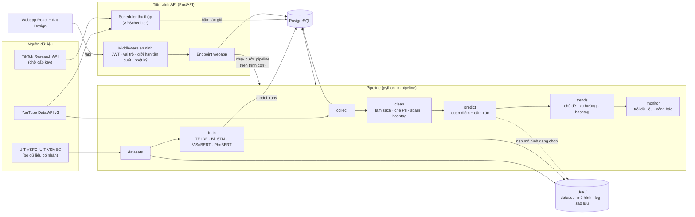
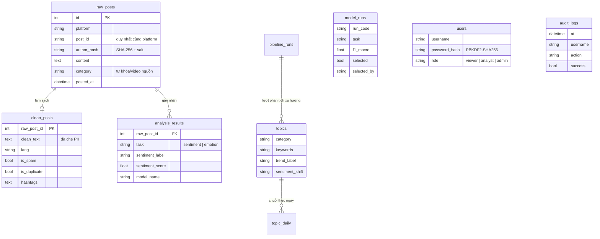

# Kiến trúc hệ thống (hiện trạng)

Tài liệu mô tả hệ thống **đang chạy** trong repo, dùng cho chương thiết kế của báo cáo (đầu việc T-07). Kiến trúc mục tiêu theo thuyết minh có thêm hàng đợi Kafka/RabbitMQ; bản hiện tại chưa có hàng đợi (xem mục 5).

## 1. Thành phần và luồng dữ liệu

| Thành phần | Mã nguồn | Ghi chú |
|---|---|---|
| Thu thập | `collector/` | API chính thức; băm định danh tác giả SHA-256 + salt trước khi ghi DB |
| Làm sạch | `preprocessing/text.py` | Unicode NFC, dấu thanh, teencode, emoji, che SĐT/email/@tên, spam, ngôn ngữ, hashtag |
| Dataset | `pipeline/datasets.py` | Tải UIT-VSFC/UIT-VSMEC, làm sạch bằng cùng hàm, kiểm tra rò rỉ train↔test |
| Huấn luyện, đánh giá | `models/sentiment/train.py` | Mỗi lần chạy ghi `model_runs` và thư mục `data/models/<mã>` |
| Dự đoán | `models/sentiment/predict.py` | Dùng mô hình đang được chọn (F1-macro cao nhất hoặc quản trị chọn tay) |
| Xu hướng | `models/trend/trends.py` | TF-IDF + NMF theo chủ đề thu thập; luật 3 ngày so với 7 ngày trước |
| Điều phối | `pipeline/` | Mỗi bước ghi `pipeline_runs` (thời gian, số bản ghi vào/ra, lỗi) |
| API + an ninh | `api/`, `security/` | Mọi route cần đăng nhập trừ `/health`; route chưa khai báo mặc định chỉ quản trị |
| Webapp | `frontend/` | Tổng quan, Xu hướng, Dữ liệu đã phân tích, Thu thập, Mô hình, Pipeline, Người dùng & nhật ký |
| Thực nghiệm | `experiments/` | Kết quả ở `data/experiments/*.json`, hiển thị ở mục Mô hình |

## 2. Mô hình dữ liệu

Các bảng cấu hình thu thập (`search_queries`, `tracked_videos`, `scheduler_state`) và `pipeline_runs` không vẽ để sơ đồ gọn.

## 3. An ninh an toàn theo lớp (thuyết minh mục 6.8)

| Lớp | Biện pháp đã có | Còn thiếu |
|---|---|---|
| Dữ liệu | Băm tác giả khi thu thập; che SĐT/email/@tên; sao lưu `python -m storage.backup`; bí mật trong `.env` | Mã hóa khi lưu, HTTPS, mã hóa bản sao lưu |
| Ứng dụng | Đăng nhập JWT, 3 vai trò, mật khẩu PBKDF2-SHA256, chặn dò mật khẩu, header bảo mật | Phiên làm mới token, 2 lớp xác thực |
| API | Mọi route cần quyền (mặc định chỉ quản trị), giới hạn tần suất theo IP, kiểm tra dữ liệu vào (Pydantic), chỉ chạy lệnh pipeline cố định | API gateway |
| Mô hình | Giám sát trôi phân phối nhãn và độ tin cậy; kiểm tra rò rỉ dataset; thực nghiệm đầu độc dữ liệu + phòng vệ; thực nghiệm DP-SGD; kiểm thử độ bền | DP cho toàn bộ Transformer; chống trích xuất mô hình ngoài giới hạn tần suất |
| Lưu vết | `audit_logs`: đăng nhập, thao tác ghi, xem dữ liệu chi tiết, bị từ chối, vượt giới hạn | Chính sách thời gian lưu nhật ký |

## 4. Phân quyền

| Vai trò | Được làm |
|---|---|
| Người xem | Tổng quan, Xu hướng, Mô hình (chỉ số liệu tổng hợp) |
| Phân tích viên | + dữ liệu chi tiết (đã che PII), cấu hình thu thập, chạy các bước pipeline (trừ huấn luyện) |
| Quản trị | + nội dung gốc, huấn luyện / chọn mô hình, tài khoản, nhật ký truy cập |

## 5. Khác biệt so với kiến trúc mục tiêu trong thuyết minh

- **Hàng đợi (Kafka/RabbitMQ):** chưa có. Các bước trao đổi qua PostgreSQL. Mỗi bước chỉ xử lý bản ghi chưa xử lý, nên chạy lại không bị trùng. Với quy mô thu thập bị giới hạn bởi quota YouTube, cách này đủ dùng. Hàng đợi chỉ cần khi thu thập nhiều nguồn đồng thời (T-13).
- **Phân tích thời gian thực:** pipeline chạy theo lượt (batch), không xử lý luồng liên tục.
