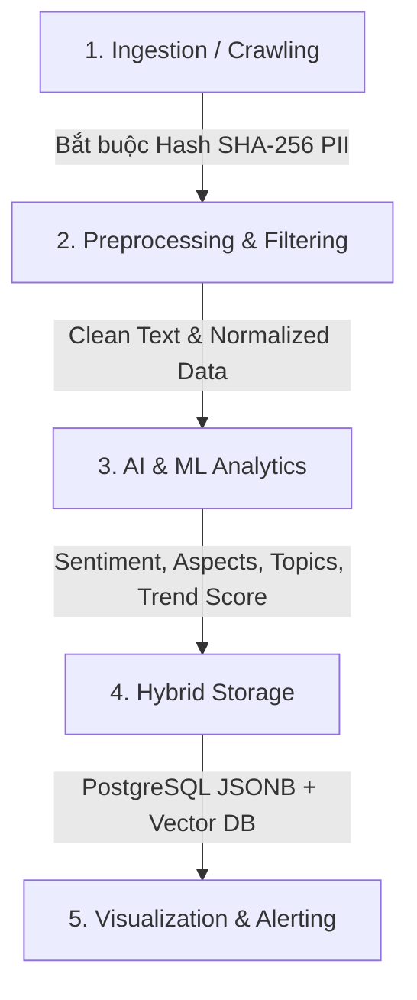

# PHÂN TÍCH NGHIỆP VỤ VÀ KHUNG KHẢO SÁT HỆ THỐNG THU THẬP, LƯU TRỮ VÀ PHÂN TÍCH CẢM XÚC - XU HƯỚNG MẠNG XÃ HỘI BẢO ĐẢM AN NINH AN TOÀN

> **Đề tài NCKH / Luận văn Thạc sĩ**:  
> *"Nghiên cứu các kỹ thuật máy học hiện đại kết hợp đảm bảo an ninh an toàn ứng dụng trong phát triển thử nghiệm hệ thống thông tin hỗ trợ thu thập, lưu trữ tự động dữ liệu mạng xã hội để nhận diện và phân loại cảm xúc và xu hướng của người dùng."*
>
> **Dự án**: Social Sentiment System  
> **Tài liệu**: Phân tích Nghiệp vụ & Khung Khảo sát Yêu cầu Hệ thống  
> **Cập nhật**: Tháng 9/2026  

---

## TỔNG QUAN ĐỀ TÀI

Đề tài nghiên cứu là một bài toán **liên ngành (Interdisciplinary)** phức hợp, đặt ở giao điểm của 3 lĩnh vực quan trọng:
1. **Khoa học Dữ liệu & Trí tuệ Nhân tạo (AI/ML & NLP)**: Nhận diện cảm xúc (Sentiment Analysis), phân tích khía cạnh (Aspect-Based Sentiment Analysis - ABSA), gom cụm chủ đề (Topic Modeling) và dự báo xu hướng (Trend Prediction).
2. **Kỹ thuật Hệ thống & Dữ liệu lớn (Data & Software Engineering)**: Thu thập tự động đa nền tảng (YouTube, TikTok, Facebook), xử lý dữ liệu dòng/lô (Streaming/Batch), chuẩn hóa Schema và lưu trữ cơ sở dữ liệu lai (Hybrid DB).
3. **An toàn An ninh Thông tin & Pháp lý (Cybersecurity & Privacy)**: Tuân thủ Luật An ninh mạng, Nghị định 13/2023/NĐ-CP (Bảo vệ dữ liệu cá nhân PII), ẩn danh hóa thông tin người dùng, chống tấn công botnet/seeding làm sai lệch mô hình AI và bảo mật hệ thống.

---

## PHẦN I. PHÂN TÍCH NGHIỆP VỤ BẮT ĐẦU TỪ ĐÂU? (3 TRỤ CỘT NGUỒN)

Để bài toán phân tích nghiệp vụ đạt độ sát thực tế cao nhất, không bị mông lung hay xa rời ứng dụng thực tiễn, quy trình phân tích phải bắt đầu đồng thời từ **3 trụ cột nguồn**:

### 1. Nguồn Nghiệp vụ Đơn vị Sử dụng & Nhu cầu Thực tiễn (Stakeholders & Business Drivers)
* **Đối tượng sử dụng hệ thống**: Cơ quan quản lý truyền thông, trung tâm giám sát thông tin mạng, hoặc bộ phận Marketing/PR/Quản trị thương hiệu của các tổ chức, doanh nghiệp.
* **Các nỗi đau thực tế (Pain Points)**:
  * **Bùng nổ thông tin (Data Explosion)**: Hàng triệu bài đăng và bình luận phát sinh mỗi ngày trên các nền tảng mạng xã hội khiến việc theo dõi thủ công là hoàn toàn bất khả thi.
  * **Thiếu khả năng phát hiện sớm bài viết tiêu cực/châm biếm**: Các bình luận sử dụng từ ngữ mỉa mai (Sarcasm), teencode hoặc ẩn ý gây khó khăn cho việc nhận diện khủng hoảng truyền thông.
  * **Bị động trong dự báo xu hướng**: Không phát hiện kịp thời các chủ đề đang nhen nhóm (Rising Trends) để đưa ra định hướng hoặc phản ứng chính xác.

### 2. Nguồn Kỹ thuật Máy học Hiện đại & Xử lý Dữ liệu (AI/ML & Data Engineering)
* **Đặc thù dữ liệu Mạng xã hội Tiếng Việt**: Ngôn ngữ mạng chứa nhiều teencode (*"j2", "ko", "dc"*), từ lóng thay đổi theo thời gian, câu viết không dấu, biểu cảm icon/emoji đi kèm.
* **Bộ công cụ & Mô hình AI hiện đại**:
  * **Xử lý Ngôn ngữ Tự nhiên (NLP)**: Sử dụng các mô hình ngôn ngữ tiền huấn luyện dành riêng cho tiếng Việt như **PhoBERT**, **XLM-RoBERTa** hoặc kết hợp các mô hình đại ngôn ngữ (LLM - Gemini, Qwen, Llama).
  * **Xử lý Đa thức (Multimodal Analysis)**: Chuyển giọng nói trong video ngắn thành văn bản (Speech-to-Text via OpenAI Whisper ASR) và đọc chữ chèn trên màn hình video (OCR via VietOCR).
  * **Gom cụm & Khía cạnh**: Thuật toán gom cụm chủ đề không giám sát (**BERTopic**, LDA) kết hợp Phân loại Cảm xúc theo Khía cạnh (**ABSA**).

### 3. Nguồn An ninh An toàn Thông tin & Quy định Pháp lý (Security & Compliance)
* **Tuân thủ Pháp luật Việt Nam**: Theo Nghị định 13/2023/NĐ-CP và Luật An ninh mạng, hệ thống **tuyệt đối không được phép lưu trữ nguyên bản Thông tin Nhận dạng Cá nhân (PII)** như Tên thật, Số điện thoại, Email, Avatar hay Username gốc.
* **Kỹ thuật Bảo mật & An toàn**:
  * **Ẩn danh hóa (Anonymization)**: Mã hóa danh tính người dùng `author_identifier` thành chuỗi Hash SHA-256 (`author_hash`) ngay tại bước Ingestion.
  * **Chống Nhiễu & Tấn công Seeding/Botnet**: Lọc các bình luận lặp đi lặp lại do mạng lưới botnet đăng tải nhằm làm lệch kết quả dự báo của AI.
  * **Bảo vệ Hệ thống**: Quản lý an toàn API Keys/Token thu thập, phân quyền truy cập dữ liệu (RBAC), phòng chống tấn công vào hệ thống lưu trữ.

---

## PHẦN II. PHƯƠNG PHÁP PHÂN TÍCH NGHIỆP VỤ SÁT THỰC TẾ

Để chuyển hóa các nguồn phân tích trên thành thiết kế phần mềm sát thực tế, áp dụng **3 phương pháp tiếp cận cốt lõi**:

### 1. Phân tích theo Chu trình Vòng đời Dữ liệu (Data Lifecycle Approach)

* **Bước 1: Thu thập (Ingestion)**: Xác định nền tảng thu thập (YouTube, TikTok, Facebook), phương thức (API chính thức vs Playwright Scraping), hạn ngạch Quota, Rate Limit và chiến lược crawling (Targeted / Incremental Crawling).
* **Bước 2: Tiền xử lý & An toàn (Preprocessing & Anonymization)**: Mã hóa danh tính người dùng thành `author_hash`, lọc trùng bình luận bằng Cosine Similarity, chuẩn hóa teencode, loại bỏ spam.
* **Bước 3: Phân tích AI & Máy học (AI/ML Analytics)**: Phân loại Cảm xúc (Tích cực / Tiêu cực / Trung tính), Phân tích Khía cạnh (ABSA), Gom cụm Chủ đề (Topic Modeling) và Tính toán Chỉ số Tăng trưởng Xu hướng.
* **Bước 4: Lưu trữ Lai (Hybrid Storage)**: Lưu trữ dữ liệu quan hệ và thuộc tính linh hoạt (PostgreSQL + JSONB) kết hợp lưu trữ Vector Embedding (Qdrant / ChromaDB) phục vụ tìm kiếm ngữ nghĩa.
* **Bước 5: Phục vụ & Cảnh báo (Serving & Alerting)**: Cảnh báo bài đăng tiêu cực phát tán nhanh, trực quan hóa biểu đồ diễn biến xu hướng trên Dashboard.

### 2. Phân tích theo Ma trận 5W1H

| Thành tố 5W1H | Nội dung Phân tích Chi tiết |
| :--- | :--- |
| **What (Cái gì)** | - Dữ liệu thu thập: Bài đăng, bình luận, chỉ số tương tác (Like, Share, Comment, View), Hashtag, Video Transcript, OCR overlay text. - Kết quả phân tích: Nhãn cảm xúc, chỉ số Sentiment Index, danh sách khía cạnh (Aspects), danh mục chủ đề (Topics), điểm số Trend (Virality Score). |
| **Who (Ai)** | - Đối tượng đăng bài: Mã hóa danh tính thành `author_hash` (SHA-256) ngay tại tầng Ingestion. - Đối tượng sử dụng hệ thống: Administrator (Quản trị hệ thống), Data Analyst (Chuyên viên phân tích dư luận), Viewer (Người xem báo cáo). |
| **Where (Ở đâu)** | - Nguồn dữ liệu: YouTube Data API v3, TikTok Research API / Playwright, Facebook Public Pages. - Môi trường triển khai: Môi trường Dev, Môi trường Evaluation (Gold Standard), Môi trường Prod. |
| **When (Khi nào)** | - Chu kỳ thu thập: Lập lịch chạy (Cron/Celery/APScheduler) theo 15 phút, 1 giờ hoặc theo thời gian thực (Real-time). - Thời gian bài đăng: Lưu trữ `posted_at` (thời điểm đăng gốc) và `collected_at` (thời điểm crawl) để phục vụ bài toán chuỗi thời gian (Time-series). |
| **Why (Tại sao)** | - Phát hiện sớm khủng hoảng truyền thông trước khi bùng phát. - Đo lường phản hồi thật sự của người dùng về sản phẩm, dịch vụ hoặc sự kiện xã hội. - Dự báo xu hướng quan tâm của cộng đồng phục vụ công tác chỉ đạo/định hướng. |
| **How (Như thế nào)** | - Áp dụng mô hình AI: PhoBERT / XLM-RoBERTa / BERTopic / OpenAI Whisper. - Bảo đảm an toàn an ninh: Hash PII, Mã hóa kết nối SSL/TLS, Quản lý API Key bằng biến môi trường/Vault, Phân quyền RBAC. |

### 3. Phân tích theo Ca sử dụng Thực tế (Real-world Use Cases)
* **Ca sử dụng 1: Giám sát & Cảnh báo Khủng hoảng Truyền thông (Crisis Management)**
  * *Kịch bản*: Một bài viết tiêu cực về sản phẩm/dịch vụ xuất hiện, lượng bình luận tiêu cực tăng gấp 300% trong vòng 2 giờ.
  * *Yêu cầu hệ thống*: Phát hiện bài viết có tốc độ lan truyền cao, phân loại cảm xúc tiêu cực, trích xuất khía cạnh bị phàn nàn và gửi cảnh báo ngay lập tức qua Telegram/Email.
* **Ca sử dụng 2: Phân tích Cảm xúc theo Khía cạnh Sản phẩm (Aspect-Based Sentiment - ABSA)**
  * *Kịch bản*: Doanh nghiệp ra mắt dòng xe điện mới.
  * *Yêu cầu hệ thống*: Tự động bóc tách bình luận thành từng khía cạnh cụ thể ("Pin" -> Tích cực 85%; "Giá bán" -> Tiêu cực 70%; "Thiết kế" -> Tích cực 90%).
* **Ca sử dụng 3: Nhận diện & Dự báo Xu hướng Mới (Trend Spotting)**
  * *Kịch bản*: Cụm từ khóa hoặc chủ đề mới nhen nhóm trên TikTok/YouTube.
  * *Yêu cầu hệ thống*: Gom cụm bài viết (BERTopic), tính điểm lan truyền (Virality Rate) và xếp hạng Top Trend nổi bật trong 24 giờ qua.

---

## PHẦN III. KHUNG KHẢO SÁT CHI TIẾT YÊU CẦU HỆ THỐNG (REQUIREMENTS SURVEY FRAMEWORK)

Khung khảo sát này được thiết kế thành **5 mô-đun nghiệp vụ chuẩn hóa**, dùng để phỏng vấn chuyên gia, thu thập yêu cầu người dùng hoặc làm căn cứ xây dựng Phụ lục khảo sát trong Luận văn/NCKH.

---

### 📋 MÔ-ĐUN 1: Khảo sát Phạm vi & Yêu cầu Thu thập Dữ liệu (Data Ingestion)

**1.1. Nền tảng mạng xã hội mục tiêu ưu tiên thu thập:**
* [ ] **YouTube**: Video metadata, danh sách bình luận (YouTube Data API v3).
* [ ] **TikTok**: Video ngắn, bình luận, transcript âm thanh, overlay text.
* [ ] **Facebook**: Bài viết công khai trên Fanpage, tin tức, bình luận công khai.
* [ ] **Báo chí trực tuyến & Forums**: Trang tin tức, trang diễn đàn thảo luận.

**1.2. Phương thức định hướng đối tượng thu thập:**
* [ ] Thu thập theo **Bộ từ khóa / Hashtag** (Keyword-based Crawling).
* [ ] Thu thập theo **Danh sách Kênh / Creator / KOLs** (Account-based Crawling).
* [ ] Thu thập theo **Danh sách URL bài viết cụ thể** do người dùng nhập vào.

**1.3. Khối lượng và Tần suất thu thập dữ liệu:**
* Khối lượng dữ liệu dự kiến cần xử lý mỗi ngày:  
  * [ ] Dev / Thử nghiệm: 500 – 1,000 bản ghi/ngày.
  * [ ] Đánh giá Mô hình (Evaluation): 3,000 – 10,000 bản ghi gán nhãn Gold Standard.
  * [ ] Môi trường Prod: 10,000 – 100,000+ bản ghi/ngày.
* Tần suất quét cập nhật bài đăng/bình luận mới (Incremental Crawling):
  * [ ] Theo thời gian thực (Streaming / Subscriptions).
  * [ ] Chu kỳ ngắn: 15 phút / 30 phút một lần.
  * [ ] Chu kỳ dài: 1 giờ / 6 giờ / 24 giờ một lần.

**1.4. Yêu cầu xử lý dữ liệu Đa phương tiện (Multimodal Data):**
* [ ] Có cần trích xuất âm thanh video thành văn bản (Speech-to-Text via OpenAI Whisper)?
* [ ] Có cần đọc chữ chèn trên khung hình video (OCR overlay text via VietOCR)?
* [ ] Chỉ tập trung xử lý dữ liệu văn bản (Text Content & Comments).

---

### 📋 MÔ-ĐUN 2: Khảo sát Yêu cầu Phân tích AI & Máy học (AI/ML & NLP)

**2.1. Yêu cầu Phân loại Cảm xúc (Sentiment Analysis):**
* Cấp độ phân tích cảm xúc:
  * [ ] Cấp độ Bình luận / Bài đăng (Comment/Post-level: Tích cực / Tiêu cực / Trung tính).
  * [ ] Cấp độ Khía cạnh (Aspect-Based Sentiment Analysis - ABSA).
  * [ ] Cấp độ Tổng hợp Chủ đề theo Thời gian (Aggregate Sentiment Index).
* Thước đo đánh giá độ chính xác mô hình AI:
  * Yêu cầu chỉ số F1-Score / Accuracy tối thiểu: $\ge 80\%$ trên tập Test Gold Standard.
  * Chỉ số đồng thuận gán nhãn (Fleiss' Kappa / Cohen's Kappa): $\ge 0.75$.

**2.2. Yêu cầu xử lý đặc thù Ngôn ngữ Mạng xã hội Tiếng Việt:**
* [ ] Có cần xây dựng Bộ từ điển chuẩn hóa Teencode / Từ lóng (Slang) MXH?
* [ ] Có cần mô hình phát hiện câu mang tính mỉa mai / châm biếm (Sarcasm Detection)?
* [ ] Có cần tự động nhận diện câu hỏi (Question), lời than phiền (Complaint), quảng cáo/spam (Ad)?

**2.3. Yêu cầu Phân tích & Dự báo Xu hướng (Trend Prediction):**
* Tiêu chí xác định một Chủ đề trở thành Trend:
  * Tốc độ tăng trưởng lượng tương tác/bình luận vượt quá: ........% trong khoảng thời gian ........ giờ.
  * Số lượng kênh/người dùng tham gia thảo luận đạt ngưỡng: ........ người dùng.
* Thuật toán phân loại/gom cụm chủ đề ưu tiên:
  * [ ] BERTopic (Gom cụm ngữ nghĩa dựa trên Transformer Embeddings).
  * [ ] LDA (Latent Dirichlet Allocation - Gom cụm thống kê).
  * [ ] Phân loại dựa trên mô hình đại ngôn ngữ (LLM Zero-shot/Few-shot Classification).

---

### 📋 MÔ-ĐUN 3: Khảo sát Yêu cầu An ninh An toàn & Pháp lý (Security & Privacy)

**3.1. Yêu cầu Tuân thủ Bảo vệ Dữ liệu Cá nhân (Nghị định 13/2023/NĐ-CP):**
* [x] **Bắt buộc**: Mã hóa/Hash toàn bộ danh tính gốc người dùng (`author_identifier`) thành chuỗi SHA-256 (`author_hash`) ngay tại khâu Ingestion trước khi ghi vào Database.
* [x] **Bắt buộc**: Không lưu trữ các trường dữ liệu nhạy cảm PII (Tên thật, Số điện thoại, Email, Địa chỉ, Avatar gốc).

**3.2. Yêu cầu Lọc Nhiễu, Spam và Chống Tấn công Seeding/Botnet:**
* Cơ chế phát hiện và loại bỏ bình luận Spam/Seeding:
  * [ ] Lọc trùng lắp nội dung bình luận bằng Cosine Similarity (Ngưỡng trùng $\ge 90\%$).
  * [ ] Đánh dấu Spam nếu 1 `author_hash` đăng cùng nội dung trên N bài viết trong khoảng thời gian ngắn.
  * [ ] Lọc bỏ bài viết/bình luận có chứa từ khóa quảng cáo, link độc hại.

**3.3. Yêu cầu An toàn Kỹ thuật & Bảo mật Hệ thống:**
* [ ] Quản lý toàn bộ API Keys, Secret Tokens bằng biến môi trường (Environment Variables) hoặc Vault.
* [ ] Phân quyền người dùng dựa trên vai trò (Role-Based Access Control - RBAC):
  * **Admin**: Quản trị hệ thống, cấu hình crawler, quản lý mô hình AI.
  * **Analyst**: Phân tích dữ liệu, xem báo cáo chi tiết, tùy chỉnh bộ từ khóa.
  * **Viewer**: Chỉ xem Dashboard trực quan hóa tổng quan.
* [ ] Mã hóa dữ liệu đường truyền (SSL/TLS HTTPS) và bảo mật CSDL (Encryption at Rest).

---

### 📋 MÔ-ĐUN 4: Khảo sát Yêu cầu Lưu trữ & Hiệu năng (Storage & Performance)

**4.1. Yêu cầu Kiến trúc Cơ sở Dữ liệu:**
* [ ] Sử dụng Cơ sở dữ liệu lai (Hybrid Architecture) dựa trên **PostgreSQL**:
  * PostgreSQL RDBMS cho dữ liệu quan hệ có cấu trúc.
  * Native `JSONB` cho thuộc tính linh hoạt của từng nền tảng MXH.
* [ ] Sử dụng **Vector Database** (Qdrant / ChromaDB) lưu trữ Embeddings phục vụ tìm kiếm ngữ nghĩa (Semantic Search) và gom cụm chủ đề.

**4.2. Yêu cầu Chính sách Lưu trữ (Data Retention Policy):**
* Thời gian lưu trữ dữ liệu thô (Raw Posts/Comments):
  * [ ] 3 tháng | [ ] 6 tháng | [ ] 12 tháng | [ ] Vĩnh viễn.
* Thời gian lưu trữ chỉ số tổng hợp (Aggregated Metrics / Trend Indices):
  * [ ] 1 năm | [ ] 3 năm | [ ] Vĩnh viễn.

**4.3. Yêu cầu Chi tiết về Hiệu năng (Performance Constraints):**
* Thời gian truy vấn tải trang Dashboard tổng quan: $< 2.0$ giây.
* Thời gian xử lý tiền xử lý + gán nhãn AI cho mỗi bản ghi: $< 0.5$ giây.
* Độ sẵn sàng của hệ thống (Uptime): $\ge 99.5\%$.

---

### 📋 MÔ-ĐUN 5: Khảo sát Yêu cầu Đầu ra & Giao diện (Output & UI/UX)

**5.1. Yêu cầu các Thành phần Trực quan hóa (Dashboard Widgets):**
* [ ] **Biểu đồ Cảm xúc theo Thời gian**: Diễn biến chỉ số Sentiment Index (Tích cực / Tiêu cực / Trung tính).
* [ ] **Đám mây Từ khóa (WordCloud)**: Hiển thị từ khóa nổi bật, mã hóa màu theo cảm xúc (Xanh = Tích cực, Đỏ = Tiêu cực, Xám = Trung tính).
* [ ] **Bảng xếp hạng Top Trend**: Danh sách các chủ đề/từ khóa có tốc độ tăng trưởng cao nhất.
* [ ] **Phân tích Aspect (Biểu đồ Cột/Radar)**: Tỷ lệ cảm xúc theo từng khía cạnh cụ thể của sản phẩm/chủ đề.
* [ ] **Bản đồ Mạng lưới (Co-occurrence Network)**: Mối liên hệ giữa các từ khóa và chủ đề thảo luận.

**5.2. Yêu cầu Kênh Cảnh báo (Alerting System):**
* Nhận thông báo tự động khi xuất hiện bài viết tiêu cực phát tán nhanh hoặc Trend mới bùng phát qua:
  * [ ] Notification trực tiếp trên Web Dashboard.
  * [ ] Thông báo qua Telegram Bot / Zalo OA.
  * [ ] Gửi Email cảnh báo tự động.

**5.3. Yêu cầu Xuất Báo cáo (Export Functionality):**
* Định dạng báo cáo cần xuất:
  * [ ] Báo cáo tổng hợp dạng tài liệu PDF / Word.
  * [ ] Xuất dữ liệu bảng dạng Excel (XLSX) / CSV.
  * [ ] Cung cấp RESTful API endpoint cho hệ thống bên thứ ba tích hợp.

---

## PHẦN IV. HƯỚNG DẪN ÁP DỤNG VÀO BÁO CÁO NCKH / LUẬN VĂN THẠC SĨ

1. **Ứng dụng vào Chương Phân tích Yêu cầu (Requirements Analysis Chapter)**:
   * Trích dẫn Phần I (3 Trụ cột nguồn) và Phần II (Data Lifecycle & 5W1H) để làm rõ cơ sở lý luận, phương pháp tiếp cận khoa học và tính cấp thiết của đề tài.
2. **Ứng dụng vào Phụ lục Khảo sát (Survey Questionnaire Appendix)**:
   * Đưa toàn bộ Phần III thành Phiếu khảo sát thực tế nhằm thu thập thông tin từ chuyên gia AI, kỹ sư dữ liệu hoặc đơn vị thử nghiệm hệ thống.
3. **Ứng dụng vào Chương Thiết kế Hệ thống (System Design Chapter)**:
   * Áp dụng các kết quả khảo sát từ Phần III để xây dựng các sơ đồ thiết kế UML tiêu chuẩn:
     * **Sơ đồ Use Case**: Các chức năng chính tương ứng với các vai trò người dùng (RBAC).
     * **Sơ đồ Luồng Dữ liệu (DFD)**: Luồng dữ liệu qua 5 bước của Data Lifecycle.
     * **Thiết kế Cơ sở Dữ liệu (ERD & Schema)**: Áp dụng bảng `raw_posts` PostgreSQL JSONB kết hợp Hashing SHA-256 PII và Vector DB.

---

> 📌 *Tài liệu này là sản phẩm phân tích nghiệp vụ chính thức phục vụ cho Đề tài NCKH & Luận văn Thạc sĩ thuộc Dự án Social Sentiment System.*
