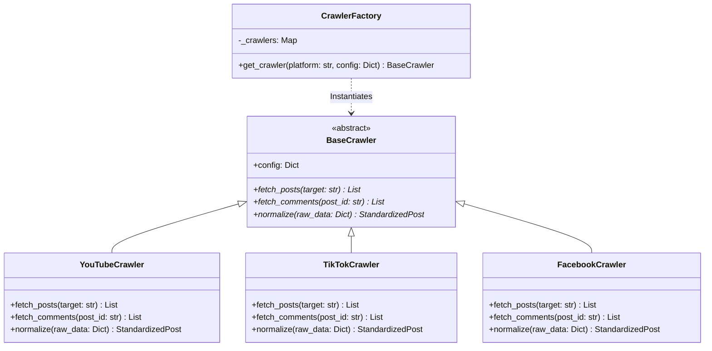
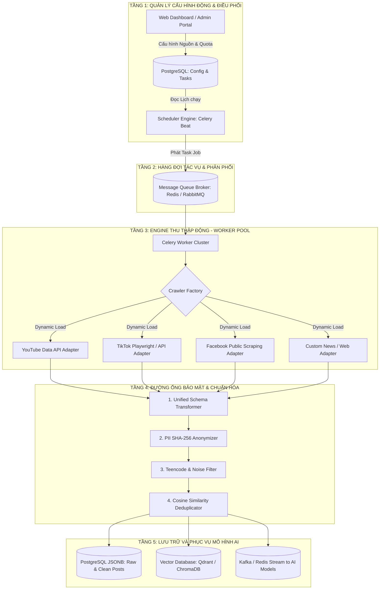

# THIẾT KẾ KIẾN TRÚC THU THẬP DỮ LIỆU ĐỘNG ĐA NỀN TẢNG MẠNG XÃ HỘI BẢO ĐẢM AN NINH AN TOÀN

> **Đề tài NCKH / Luận văn Thạc sĩ**:  
> *"Nghiên cứu các kỹ thuật máy học hiện đại kết hợp đảm bảo an ninh an toàn ứng dụng trong phát triển thử nghiệm hệ thống thông tin hỗ trợ thu thập, lưu trữ tự động dữ liệu mạng xã hội để nhận diện và phân loại cảm xúc và xu hướng của người dùng."*
>
> **Dự án**: Social Sentiment System  
> **Tài liệu**: Thiết kế Kiến trúc Thu thập Động (Dynamic Multi-Platform Ingestion Architecture)  
> **Cập nhật**: Tháng 9/2026  

---

## I. ĐẶT VẤN ĐỀ VÀ MỤC TIÊU KIẾN TRÚC

### 1. Thách thức trong Thu thập Dữ liệu Mạng Xã hội Đa Nguồn
Khi phát triển hệ thống thu thập dữ liệu từ các mạng xã hội khác nhau (YouTube, TikTok, Facebook, Shopee, Báo chí trực tuyến), hệ thống phải đối mặt với các thách thức kỹ thuật lớn:
* **Sự dị biệt về cấu trúc dữ liệu thô (Schema Heterogeneity)**: Mỗi nền tảng sử dụng định dạng dữ liệu trả về khác nhau (YouTube API dùng REST/JSON dạng snippet, TikTok dùng GraphQL/Protobuf, Facebook dùng Graph API hoặc HTML DOM).
* **Cơ chế truy cập và giới hạn khác nhau (Access & Rate Limiting)**: Một số nền tảng hỗ trợ API chính thức có Quota (YouTube), một số nền tảng bị bóp băng thông/chặn Cloudflare (Facebook, Shopee), một số yêu cầu giải trình đơn nghiên cứu khoa học (TikTok Research API).
* **Rủi ro An toàn Thông tin & Pháp lý (Security & PII Risk)**: Dữ liệu mạng xã hội chứa thông tin cá nhân (PII - Publicly Identifiable Information). Việc thu thập và lưu trữ trực tiếp tên thật, username, avatar vi phạm Nghị định 13/2023/NĐ-CP và Luật An ninh mạng.
* **Thay đổi liên tục từ nhà cung cấp nền tảng (Platform Evolution)**: Cấu trúc HTML/API của các mạng xã hội thường xuyên cập nhật. Nếu mã nguồn thu thập bị kết nối cứng (hardcode), bất kỳ thay đổi nào từ một nền tảng cũng có thể gây gián đoạn toàn bộ hệ thống.

### 2. Mục tiêu Thiết kế Kiến trúc Thu thập Động
* **Tính mở rộng không gián đoạn (Non-disruptive Extensibility)**: Dễ dàng thêm nền tảng thu thập mới (VD: Threads, Instagram, Zalo) bằng cách bổ sung bộ cắm (Adapter/Plugin) mới mà không cần chỉnh sửa mã nguồn lõi hay dừng hệ thống.
* **Cấu hình Động qua Giao diện/CSDL (Dynamic Configuration)**: Cho phép thay đổi danh sách từ khóa, đối tượng thu thập, tần suất quét và hạn ngạch Quota hoàn toàn qua Database/Dashboard UI mà không phải khởi động lại service.
* **Chuẩn hóa Hợp đồng Dữ liệu (Uniform Data Contract)**: Đảm bảo toàn bộ dữ liệu từ mọi nguồn đều được chuyển đổi về một cấu trúc chuẩn nhất quán trước khi lưu trữ hoặc đưa vào mô hình AI.
* **Bảo mật và Khả năng chịu lỗi cao (Security & Resilience)**: Tự động Hash PII (SHA-256) tại tầng Ingestion, quản lý Proxy xoay, tự động khôi phục và cô lập lỗi (Fault Isolation).

---

## II. CÁC MẪU THIẾT KẾ PHẦN MỀM CỐT LÕI (DESIGN PATTERNS)

Để đạt được mục tiêu kiến trúc động, hệ thống vận dụng **4 mẫu thiết kế phần mềm kinh điển**:

### 1. Adapter / Strategy Pattern (Mẫu Adapter / Chiến lược)
* **Khái niệm**: Định nghĩa lớp trừu tượng `BaseCrawler` đóng vai trò làm Giao diện mẫu (Contract Interface).
* **Ứng dụng**: Mỗi mạng xã hội cụ thể được coi là một `Adapter` (VD: `YouTubeAdapter`, `TikTokAdapter`). Tầng xử lý chính của hệ thống chỉ giao tiếp với `BaseCrawler` mà không cần biết chi tiết triển khai bên trong của từng nền tảng.

### 2. Factory Pattern (Mẫu Nhà xưởng)
* **Khái niệm**: Cung cấp một giao diện khởi tạo đối tượng mà không chỉ định rõ lớp chính xác sẽ được tạo.
* **Ứng dụng**: Lớp `CrawlerFactory` sẽ nhận tham số `platform` (chuỗi ký tự từ CSDL) và tự động ánh xạ, tạo ra instance của Adapter tương ứng theo cơ chế Dynamic Loading.

### 3. Pipeline Pattern (Mẫu Đường ống Xử lý)
* **Khái niệm**: Dữ liệu sau khi thu thập được truyền qua một chuỗi các bước xử lý nối tiếp nhau độc lập (Pipe & Filter).
* **Ứng dụng**: Luồng đường ống bao gồm các công đoạn: `Ingestion` $\rightarrow$ `SHA-256 PII Hashing` $\rightarrow$ `Text Normalization & Clean` $\rightarrow$ `Deduplication` $\rightarrow$ `Storage & AI Queue`.

### 4. Producer - Consumer Pattern (Mẫu Sản xuất - Tiêu thụ)
* **Khái niệm**: Tách rời tiến trình phát tác vụ (Scheduler/Producer) với tiến trình thực thi thu thập dữ liệu (Worker Pool/Consumer) thông qua Hàng đợi Thông điệp (Message Queue).
* **Ứng dụng**: Sử dụng **Celery Beat + Redis Queue** để điều phối hàng ngàn job cào dữ liệu song song bất đồng bộ.

---

## III. MÔ TẢ CHI TIẾT TẦNG KIẾN TRÚC (ARCHITECTURAL TIERS)

### 1. Tầng 1: Quản lý Cấu hình Động & Điều phối (Dynamic Control Tier)
* **Nhiệm vụ**: Lưu trữ toàn bộ thông số quản lý crawler (API Keys, Proxies, Target Keywords, KOL Channel IDs, Cron Schedules) trong CSDL PostgreSQL.
* **Hoạt động**: Người dùng thêm/sửa từ khóa hoặc dừng một nguồn cào trên Web UI, CSDL sẽ cập nhật ngay lập tức mà không làm gián đoạn hệ thống.

### 2. Tầng 2: Hàng đợi Tác vụ Bất đồng bộ (Task Queue Tier)
* **Nhiệm vụ**: Nhận các job thu thập từ Scheduler và phân phối đều cho các Worker.
* **Công nghệ**: Redis / RabbitMQ làm Message Broker.

### 3. Tầng 3: Tầng Thu thập Động (Dynamic Crawler Engine Tier)
* **Nhiệm vụ**: Thực thi cào dữ liệu từ các mạng xã hội theo mô hình Adapter.
* **Cơ chế An toàn**:
  * **Rate Limiter & Quota Monitor**: Kiểm soát số lượng request mỗi phút để tránh bị khóa IP/API.
  * **Rotating Proxy Manager**: Tự động xoay IP Proxy khi cào các trang bị giới hạn như Facebook/Shopee.
  * **Circuit Breaker**: Nếu một nguồn liên tục trả về lỗi HTTP 429 / Cloudflare CAPTCHA, hệ thống tự động tạm dừng nguồn đó và phát cảnh báo về Admin.

### 4. Tầng 4: Đường ống An toàn & Chuẩn hóa (Security & Pipeline Tier)
* **Nhiệm vụ**: 
  1. Ánh xạ dữ liệu thô về **Standardized Social Post Schema**.
  2. Bắt buộc **Hash SHA-256** trường `author_id` thành `author_hash` nhằm tuân thủ Nghị định 13/2023/NĐ-CP.
  3. Lọc nhiễu văn bản (xóa biểu tượng vô nghĩa, chuẩn hóa teencode).
  4. Loại bỏ các bình luận trùng lặp / spam botnet bằng thuật toán Cosine Similarity.

### 5. Tầng 5: Lưu trữ Lai & Phục vụ AI (Data Storage & AI Serving Tier)
* **Nhiệm vụ**: Lưu trữ lâu dài và đẩy dữ liệu sạch sang các mô hình NLP (PhoBERT, BERTopic, ABSA).
* **Công nghệ**: PostgreSQL (kết hợp native JSONB) + Vector Database (Qdrant / ChromaDB).

---

## IV. CHUẨN HÓA SCHEMA DỮ LIỆU ĐẦU RA (UNIFIED DATA CONTRACT)

Bất kể dữ liệu thu thập từ nền tảng nào, toàn bộ Adapter bắt buộc phải biến đổi dữ liệu thô về cấu trúc chuẩn **`StandardizedSocialPost`**:

| Tên trường dữ liệu | Kiểu dữ liệu | Mô tả chi tiết | Bắt buộc mã hóa / Chuẩn hóa |
| :--- | :--- | :--- | :--- |
| `platform` | `VARCHAR(50)` | Mã nền tảng (`youtube`, `tiktok`, `facebook`) | Chữ thường |
| `post_id` | `VARCHAR(128)` | ID bài đăng hoặc bình luận gốc trên MXH | Giữ nguyên nguyên bản |
| `author_hash` | `VARCHAR(64)` | Chuỗi mã hóa nhận dạng người đăng | **Bắt buộc SHA-256 (PII Protected)** |
| `content` | `TEXT` | Nội dung văn bản bài đăng / bình luận / transcript | Chuẩn hóa UTF-8, lọc teencode |
| `posted_at` | `TIMESTAMP` | Thời điểm bài viết/bình luận được đăng gốc | UTC Timestamp |
| `collected_at` | `TIMESTAMP` | Thời điểm hệ thống thực hiện thu thập | Current UTC Timestamp |
| `like_count` | `INTEGER` | Số lượng tương tác Thích (Like) | Mặc định 0 |
| `comment_count` | `INTEGER` | Số lượng Bình luận | Mặc định 0 |
| `share_count` | `INTEGER` | Số lượng Lượt chia sẻ (Share) | Mặc định 0 |
| `view_count` | `INTEGER` | Số lượng Lượt xem (View - nếu có) | Có thể NULL |
| `raw_metadata` | `JSONB` | Toàn bộ dữ liệu thô gốc của nền tảng | Lưu trữ linh hoạt dạng JSONB |

---

## V. ĐÁNH GIÁ KIẾN TRÚC TRONG BÁO CÁO NCKH / LUẬN VĂN THẠC SĨ

Kiến trúc thu thập dữ liệu động đề xuất đáp ứng xuất sắc các tiêu chí đánh giá khoa học:

1. **Tính linh hoạt & Khả năng mở rộng (Extensibility & Agility)**:
   * Việc áp dụng **Adapter & Factory Pattern** giúp hệ thống tuân thủ nguyên lý **Open-Closed Principle (SOLID)**: Mở rộng tính năng mới (thêm MXH mới) bằng cách thêm code mới, không sửa đổi code cũ.
2. **Đảm bảo An toàn An ninh & Pháp lý (Security & Compliance)**:
   * Tích hợp cơ chế ẩn danh hóa PII (SHA-256) ngay tại tầng Ingestion Pipeline bảo đảm tuân thủ Luật An ninh mạng và Nghị định 13/2023/NĐ-CP.
3. **Khả năng Chịu lỗi & Cô lập Lỗi (Fault Tolerance & Isolation)**:
   * Kiến trúc Microservices / Worker-based kết hợp với Message Queue giúp cô lập sự cố. Việc 1 crawler bị chặn IP không ảnh hưởng đến toàn bộ hệ thống thu thập còn lại.
4. **Hiệu năng & Tối ưu Tài nguyên (Performance & Resource Efficiency)**:
   * Cho phép phân bổ số lượng Worker linh hoạt theo hạn ngạch Quota và tải thực tế của từng mạng xã hội.

---

> 📌 *Tài liệu này được xuất tự động phục vụ công tác thiết kế hệ thống và viết báo cáo NCKH / Luận văn Thạc sĩ thuộc Dự án Social Sentiment System.*
