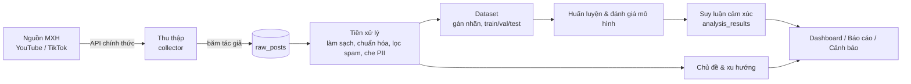

## Bên liên quan
| Bên | Nhu cầu | Ghi chú |
|---|---|---|
| Nhóm nghiên cứu (Nam, Lâm) | Dữ liệu thật để huấn luyện/đánh giá; hệ thống thử nghiệm để chứng minh kết quả | Người dùng chính trong giai đoạn đề tài |
| GV hướng dẫn / Hội đồng nghiệm thu | Thấy rõ câu hỏi nghiên cứu được trả lời, có số liệu thực nghiệm, có tuân thủ pháp lý | |
| Đơn vị ứng dụng (giả định — xem APP-*) | Lắng nghe MXH, nắm cảm xúc & xu hướng dư luận, cảnh báo sớm | Chốt ở D-009 |
| Chủ thể dữ liệu (người bình luận trên MXH) | Không bị lộ danh tính, dữ liệu dùng đúng mục đích | Luật 91/2025/QH15 |
| Nền tảng MXH (YouTube, TikTok…) | Dùng API đúng điều khoản, đúng quota | ToS từng nền tảng |

## Vai trò người dùng hệ thống (đề xuất — Q-018)
| Vai trò | Quyền |
|---|---|
| Admin | Quản trị người dùng, cấu hình nguồn thu thập, quản lý mô hình, xem audit log |
| Analyst | Cấu hình từ khóa/video theo dõi, xem dữ liệu chi tiết, chạy phân tích, xuất báo cáo |
| Viewer | Chỉ xem dashboard tổng hợp (không thấy nội dung thô) |

## Ca sử dụng chính
| Mã | Ca sử dụng | Vai trò | Trạng thái |
|---|---|---|---|
| UC-01 | Cấu hình từ khóa tìm kiếm & video theo dõi | Analyst | Đã có (FR-002, FR-003) |
| UC-02 | Thu thập tự động định kỳ | Hệ thống | Đã có (FR-003) |
| UC-03 | Xem / tìm kiếm / lọc dữ liệu đã thu thập | Analyst | Một phần (FR-006) |
| UC-04 | Gán nhãn cảm xúc tự động cho dữ liệu mới | Hệ thống | Chưa có (FR-008) |
| UC-05 | Xem dashboard cảm xúc theo thời gian | Viewer | Chưa có (FR-010) |
| UC-06 | Xem chủ đề & xu hướng nổi bật | Viewer | Chưa có (FR-009) |
| UC-07 | Đăng nhập, phân quyền | Mọi vai trò | Chưa có (FR-011) |
| UC-08 | Xuất dữ liệu / báo cáo | Analyst | Chưa có (FR-012) |
| UC-09 | Theo dõi trạng thái thu thập, lỗi, quota | Admin | Chưa có (FR-014) |
| UC-10 | Xem nhật ký hoạt động | Admin | Chưa có (FR-013) |
| UC-11 | Nhận cảnh báo khi tiêu cực/trend tăng đột biến | Analyst | Chưa có (FR-015, ưu tiên thấp) |

## Quy tắc nghiệp vụ
| Mã | Quy tắc | Hiện trạng |
|---|---|---|
| BR-01 | Định danh tác giả **phải được băm SHA-256 + salt ngay khi thu thập**, không lưu định danh gốc | Đã có (`security/anonymize.py`) |
| BR-02 | Không lưu trùng bình luận: duy nhất theo `(platform, post_id)` | Đã có (unique constraint) |
| BR-03 | Chỉ thu thập nội dung **công khai** qua **API chính thức**, tuân thủ ToS | Đã có (YouTube, TikTok) |
| BR-04 | Tôn trọng quota: YouTube 10.000 unit/ngày; `search.list` = 100 unit, `commentThreads.list` = 1 unit | Có cảnh báo trong code, chưa có giám sát (T-019) |
| BR-05 | Cấu hình thu thập lưu trong DB, scheduler đọc lại mỗi lượt — sửa qua UI có hiệu lực lượt sau | Đã có |
| BR-06 | Nội dung bình luận có thể chứa PII (SĐT, email, tên) → cần làm mờ trước khi đưa vào dataset/công bố | Chưa có (R-005, T-022) |
| BR-07 | Dữ liệu thô không commit lên git; `.env`/salt giữ bí mật | Đã có (`.gitignore`) |
| BR-08 | Chính sách thời gian lưu trữ dữ liệu thô | Chưa chốt (D-014) |

## Vòng đời dữ liệu

## Quy trình nghiệp vụ chính
1. Analyst nhập từ khóa hoặc video cần theo dõi (UI tab "Cấu hình thu thập").
2. Scheduler chạy mỗi `COLLECTOR_POLL_INTERVAL_MINUTES` phút: tìm video mới theo từ khóa, lấy bình luận, băm tác giả, ghi `raw_posts`.
3. (Chưa có) Job tiền xử lý + suy luận cảm xúc gán nhãn cho bản ghi mới → `analysis_results`.
4. (Chưa có) Job xu hướng tổng hợp theo cửa sổ thời gian → chủ đề, từ khóa nổi, chỉ số tăng trưởng.
5. Viewer/Analyst xem dashboard, xuất báo cáo.

## Thảo luận
<!-- Chỉ thêm bình luận vào cuối file. Mỗi bình luận bắt đầu bằng: ### YYYY-MM-DD HH:MM:SS · Tên -->
