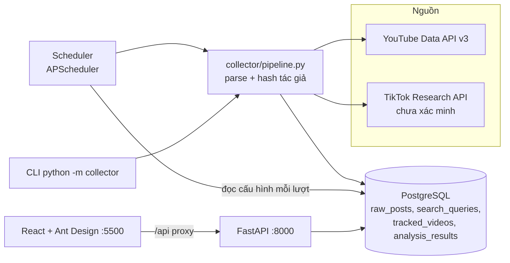
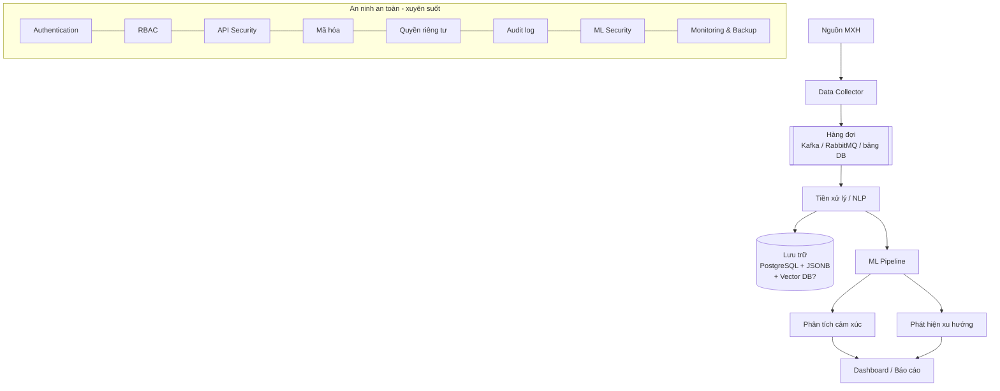
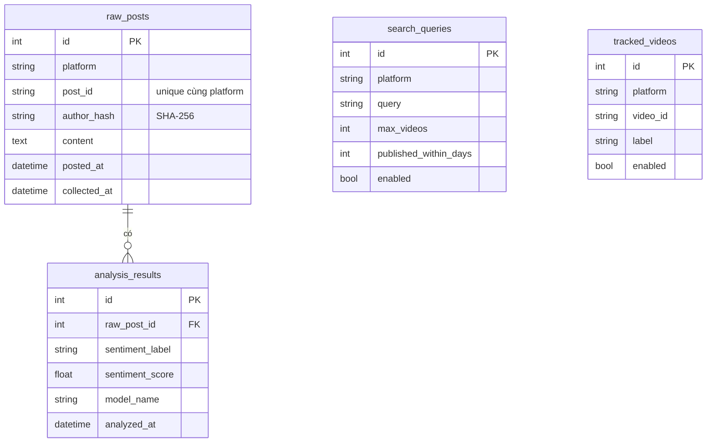

## Kiến trúc hiện trạng (code trên repo)
3 tiến trình độc lập dùng chung PostgreSQL, **chưa có hàng đợi**.

## Kiến trúc mục tiêu (theo thuyết minh — chờ chốt D-002, D-006)

## Thành phần
| Thành phần | Công nghệ | Hiện trạng | Đầu việc |
|---|---|---|---|
| Collector YouTube | httpx, YouTube Data API v3 | Đã có | T-011, T-012 |
| Collector TikTok | httpx, TikTok Research API | Scaffold, chưa test key thật | T-016 |
| Scheduler | APScheduler (BlockingScheduler) | Đã có | T-013 |
| Hàng đợi | Kafka / RabbitMQ / không dùng | Chưa có | D-002, T-020 |
| Lưu trữ | PostgreSQL 16 + SQLAlchemy 2.0 | Đã có (4 bảng) | T-009 |
| Ẩn danh | SHA-256 + salt | Đã có | T-015 |
| Tiền xử lý | underthesea / VnCoreNLP (MODEL-013) | Chưa có | T-022…T-024 |
| Mô hình cảm xúc | scikit-learn, PyTorch, Transformers | Chưa có | T-028…T-033 |
| Mô hình xu hướng | BERTopic / LDA / thống kê | Chưa có | T-034…T-037 |
| API | FastAPI | Đã có (chưa có auth) | T-038, T-039 |
| Frontend | React 19 + Ant Design 5 + Vite | Đã có (tổng quan, dữ liệu, cấu hình) | T-045…T-047 |
| Theo dõi thực nghiệm | MLflow (trong requirements, đang comment) | Chưa có | E-* |

## Mô hình dữ liệu hiện tại

**Thiếu so với nghiệp vụ** (T-009): hashtag, metadata (like, reply, tiêu đề video, kênh), quan hệ bình luận cha–con, bảng nhãn thủ công (gold), bảng chủ đề/xu hướng, bảng người dùng/vai trò, audit log, lượt chạy thu thập.

## Nhật ký quyết định kiến trúc (ADR)
| Mã | Quyết định | Lý do | Ngày |
|---|---|---|---|
| ADR-01 | Dùng API chính thức (YouTube Data API, TikTok Research API), không scraping | Tuân thủ ToS & pháp lý | Giai đoạn 2 |
| ADR-02 | Băm tác giả ngay tại collector, không lưu định danh gốc | Luật 91/2025/QH15 | Giai đoạn 0 |
| ADR-03 | Cấu hình thu thập lưu DB thay cho `.env` | Sửa qua UI, không restart scheduler | Giai đoạn 2 |
| ADR-04 | PostgreSQL làm kho chính | Quan hệ + JSONB, đủ cho quy mô thử nghiệm | Giai đoạn 0 |
| ADR-05 | … (thêm khi chốt D-002, D-006, D-008, D-012) | | |

## Thảo luận
<!-- Chỉ thêm bình luận vào cuối file. Mỗi bình luận bắt đầu bằng: ### YYYY-MM-DD HH:MM:SS · Tên -->
