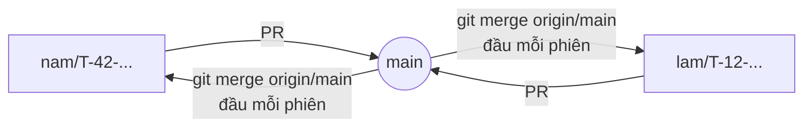

# Làm việc 2 người với Claude (vibe code) – Nam & Lâm

Mục tiêu: hai người, mỗi người một Claude, làm song song mà không giẫm chân nhau, rồi ghép vào `main` gọn gàng.

Ba nguyên tắc:

1. **Mỗi file có một chủ.** Claude của ai chỉ sửa file thuộc phần của người đó. File dùng chung thì theo [mục 4](#4-file-dùng-chung--quy-ước-sửa).
2. **Mỗi người một sổ việc riêng:** [nam.md](nam.md) và [lam.md](lam.md). Chỉ chủ sổ được sửa. Muốn nhờ người kia thì ghi vào mục "Cần người kia" trong **sổ của mình**.
3. **Mỗi đầu việc một nhánh, ghép vào `main` qua pull request (PR).** Không commit thẳng code lên `main`.

`PROJECT.md` vẫn là nơi ghi **trạng thái chính thức** của đầu việc (T-xx) và kết quả. Sổ riêng là nơi ghi **đang làm gì, làm tiếp gì, ghi chú giữa các phiên**.

---

## 1. Ai làm gì

### Phần của Lâm: thu thập, lưu trữ, hạ tầng chạy

| Thư mục / file | Nội dung |
|---|---|
| `collector/` | Client YouTube/TikTok, scheduler, ghi `raw_posts` |
| `preprocessing/cleaner.py`, `teencode.py`, `tokenizer.py`, `pipeline.py`, `README.md` | Bộ tiền xử lý của Lâm (xem [QD-11](../PROJECT.md)) |
| `tests/` | Kiểm thử pytest của các module trên |
| `run.py`, `start.bat`, `docker-compose.yml`, `HUONG_DAN_CHAY.md` | Khởi động và hạ tầng |
| `frontend/src/CollectorConfig.tsx`, `PostsTable.tsx` | Trang Thu thập |
| `docs/dynamic_crawling_architecture_design.md`, `crawling_qna_design.md` | Tài liệu thu thập |

Đầu việc: T-01, T-02, T-03, T-04 (tổng quan, GD-01), T-06, T-13 (hàng đợi), T-11 (TikTok, đang chờ key), T-12, T-37, T-46.

### Phần của Nam: học máy, phân tích, an ninh, webapp, quản lý đề tài

| Thư mục / file | Nội dung |
|---|---|
| `preprocessing/text.py`, `test_text.py` | Làm sạch dùng cho huấn luyện và dự đoán |
| `pipeline/`, `models/`, `experiments/`, `data/experiments/*.json` | Pipeline học máy, mô hình, thực nghiệm |
| `security/`, `api/app_routes.py`, `api/security_mw.py` | Đăng nhập, phân quyền, mã hóa, phát hiện tấn công |
| `storage/migrate.py`, `storage/backup.py` | Nâng cấp schema, sao lưu |
| `frontend/src/` các trang còn lại (`Dashboard`, `Trends`, `AnalysisPosts`, `Models`, `Pipeline`, `Admin`, `Login`, `ui.tsx`) | Webapp |
| `tools/`, `docs/ARCHITECTURE.md`, `HUONG_DAN_SU_DUNG.md` | Công cụ quản lý, tài liệu |

Đầu việc: T-05, T-16 (dựng công cụ gán nhãn; **cả hai cùng gán** để đo độ đồng thuận), T-31, T-32, T-34, T-36, T-38, T-42, T-47, T-49.

> Phân chia này là đề xuất, ghi ở **QD-10** trong `PROJECT.md` (trạng thái Chưa duyệt). Hai người chốt hoặc sửa ở đó. Đổi chủ một file hay đầu việc cũng ghi vào QD-10.

### Ranh giới giữa hai phần

Hai phần nói chuyện với nhau qua **bảng CSDL** và **API**. Đổi những thứ dưới đây là đổi "hợp đồng", phải báo người kia:

| Hợp đồng | Bên ghi | Bên đọc | Khi đổi |
|---|---|---|---|
| Bảng `raw_posts` (`post_id`, `author_hash`, `content`, `category`, `posted_at`) | Lâm (collector) | Nam (pipeline clean) | Thêm hoặc đổi cột: báo trước, thêm migration |
| `author_hash` phải qua `hash_identifier()` | Lâm | Mọi bên | Không bao giờ lưu ID gốc |
| `raw_posts.content` được mã hóa (`EncryptedText`) | Nam | Lâm | Không tìm kiếm SQL trên cột này |
| Bảng `tracked_videos`, `search_queries`, `scheduler_state` | Lâm | Lâm (API trong `api/main.py`) | Tự do |
| Bảng `clean_posts`, `analysis_results`, `topics`, `model_runs`… | Nam | Nam (webapp) | Tự do |
| Endpoint mới trong `api/main.py` | Lâm | — | Phải thêm 1 dòng quyền vào `RULES` trong `api/security_mw.py`, nếu không endpoint sẽ **chỉ admin** gọi được |

---

## 2. Một phiên làm việc với Claude

Mở đầu mỗi phiên, dán câu sau cho Claude (thay `<tên>` bằng `nam` hoặc `lam`):

```text
Tôi là <tên>. Đọc team/HUONG_DAN_VIBE_CODE.md và team/<tên>.md, rồi làm theo mục "Bắt đầu phiên".
Việc hôm nay: <T-xx hoặc mô tả>.
```

Claude cũng tự nhận ra bạn qua `git config user.name` (xem [mục 6](#6-quy-tắc-cho-claude)), nhưng nói rõ vẫn chắc hơn.

### Bắt đầu phiên

```bash
git fetch origin
git status                               # còn thay đổi dở thì commit hoặc stash trước
# Việc mới:
git switch -c <tên>/T-xx-mo-ta-ngan origin/main
# Hoặc tiếp tục nhánh cũ:
git switch <tên>/T-xx-...  &&  git merge origin/main
```

Nếu `requirements.txt`, `package-lock.json` hay `storage/migrate.py` vừa đổi trên `main`, chạy `start.bat` hoặc `python run.py` (tự cài lại và tự migrate). Chạy tay thì dùng `pip install -r requirements.txt`, `npm install --prefix frontend`, `python -m storage.migrate`.

Đọc thêm mục **"Cần người kia"** trong sổ của người còn lại để xem có việc gì họ nhờ mình không.

### Trong phiên

- **Một nhánh = một đầu việc (hoặc vài đầu việc nhỏ liền nhau).** Nhánh nên sống ngắn, 1–3 ngày, để ghép dễ.
- **Commit nhỏ và thường xuyên**, mỗi commit một ý.
- **Định dạng commit:** `Nam: T-42 thêm biểu đồ xu hướng theo cảm xúc` hoặc `Lâm: T-12 ...`.
- Sắp sửa file của người kia? Dừng lại, ghi vào mục "Cần người kia" trong sổ của mình. Hoặc, nếu chỉ là sửa 1–2 dòng bắt buộc, sửa rồi **ghi rõ trong mô tả PR**.

### Kết thúc phiên

```bash
python -m pytest -q                        # mọi kiểm thử Python (của cả hai)
npm run build --prefix frontend            # nếu có sửa frontend
git add -A && git commit -m "<Tên>: T-xx ..."
git push -u origin <tên>/T-xx-...
```

1. Cập nhật **sổ riêng**: chuyển việc xong sang "Đã xong gần đây", ghi một dòng vào "Nhật ký phiên".
2. Cập nhật **`PROJECT.md`** qua công cụ quản lý (`node tools/server.js`): trạng thái và nhật ký kết quả của đầu việc mình phụ trách.
3. Việc đã xong thì mở **PR** vào `main`: `gh pr create --fill`, hoặc bấm trên GitHub.

---

## 3. Ghép vào `main`



| PR chỉ sửa | Ai duyệt |
|---|---|
| File trong phần của mình (+ sổ riêng, + `PROJECT.md`) | Tự ghép được |
| Có file dùng chung hoặc file của người kia | Người kia xem trước khi ghép. Có thể nhờ Claude của họ chạy `/code-review <số PR>` |

Mẫu mô tả PR:

```markdown
**Đầu việc:** T-xx
**Đã làm:** ...
**File dùng chung đã sửa:** không / storage/models.py (thêm cột ...), ...
**Cần người kia làm sau khi ghép:** không / chạy python -m storage.migrate, ...
**Kiểm thử:** pytest ok, npm run build ok
```

Ghép xong thì xóa nhánh. Người kia sẽ nhận thay đổi ở đầu phiên sau (`git merge origin/main`).

**Khi xung đột:**

- Xung đột trong **file của mình**: tự giải quyết.
- Xung đột trong **file dùng chung**: giữ phần của cả hai, theo quy ước ở [mục 4](#4-file-dùng-chung--quy-ước-sửa).
- `frontend/package-lock.json`: lấy bản của `main` (`git checkout --theirs`), chạy `npm install` để sinh lại, rồi commit.
- `PROJECT.md`: hiếm khi xung đột, vì công cụ chỉ sửa đúng block. Nếu có, giữ dòng nhật ký của cả hai bên.
- **Không bao giờ force push** lên `main` hay lên nhánh người kia đang dùng.

---

## 4. File dùng chung – quy ước sửa

Đây là những file cả hai đều từng sửa. Quy ước chung: **chỉ thêm vào cuối phần của mình, không sắp xếp lại, không định dạng lại cả file.**

| File | Quy ước |
|---|---|
| `storage/models.py` | Mỗi class có chủ. **Lâm:** `RawPost`, `TrackedVideo`, `SearchQuery`, `SchedulerState`. **Nam:** các class còn lại. Thêm cột vào class của người kia: báo trước |
| `storage/migrate.py` (`UPGRADES`) | **Chỉ thêm vào cuối danh sách**, mỗi dòng ghi chú `# Lâm:` hoặc `# Nam:`. Không sửa hay xóa dòng cũ. Mọi câu SQL phải chạy lại được nhiều lần (`IF NOT EXISTS`) |
| `api/main.py` | Endpoint của Lâm. Endpoint của Nam nằm ở `api/app_routes.py` |
| `api/security_mw.py` (`RULES`) | Của Nam; Lâm được thêm 1 dòng quyền cho endpoint mới của mình (ghi trong PR) |
| `config/settings.py`, `.env.example` | Thêm biến vào cuối nhóm của mình, kèm chú thích. Biến mới: báo người kia thêm vào `.env` |
| `requirements.txt` | Thêm dưới tiêu đề nhóm của mình (`# ===== ... =====`). Không sắp xếp lại |
| `frontend/src/App.tsx` | Mỗi trang 1 dòng trong `PAGES` và 1 dòng trong `content`. Không đổi bố cục chung khi chưa bàn |
| `frontend/src/api.ts` | Thêm hàm và kiểu vào cuối nhóm của mình |
| `frontend/package.json`, `package-lock.json` | Chỉ đổi qua `npm install <gói>`, không sửa tay |
| `Makefile`, `README.md` | Thêm mục mới. Sửa mục của người kia: báo trước |
| `CLAUDE.md` | Thông tin chung cho cả hai Claude. Thêm hoặc sửa: ghi trong PR |
| `.gitignore`, `.gitattributes` | Chỉ thêm dòng |
| `PROJECT.md` | Sửa qua công cụ quản lý. Trạng thái: chỉ đầu việc mình phụ trách. Nhật ký thì ghi vào block nào cũng được |

**Thêm thư viện hoặc biến môi trường mới:** ghi vào "Cần người kia" trong sổ của mình và trong mô tả PR, để người kia biết mà cài hoặc thêm vào `.env` của họ.

---

## 5. Những thứ mỗi máy tự giữ (không có trên git)

| Thứ | Ghi chú |
|---|---|
| `.env` | Mỗi máy một bản. **Không bao giờ commit, không gửi qua chat** |
| `DATA_ENCRYPTION_KEY` | Mỗi máy có CSDL riêng nên có khóa riêng. Muốn chuyển bản sao lưu cho người kia thì phải gửi kèm khóa qua kênh riêng. Thường không cần: mỗi người tự thu thập hoặc sinh dữ liệu thử |
| `data/datasets/`, `data/models/` | Tự sinh bằng `python -m pipeline datasets` và `python -m pipeline train ...` |
| `data/certs/` | Tự sinh bằng `python -m security.tls` |
| `.venv/` | Môi trường Python của từng máy. Venv Windows và WSL không dùng chung được |

---

## 6. Quy tắc cho Claude

Phần này viết cho Claude của cả hai người. `CLAUDE.md` trỏ tới đây.

1. **Xác định đang làm cho ai.** Ưu tiên lời người dùng nói. Nếu không có, dựa vào `git config user.name`:
   - `namtruong03`, `nambanhboi` → **Nam**
   - `Vũ Vương Lâm`, `lamthonn` → **Lâm**

   Không rõ thì hỏi trước khi sửa gì.
2. **Đầu phiên:** làm mục "Bắt đầu phiên" ở trên.
   - Đọc sổ của người dùng (`team/<tên>.md`).
   - Đọc các block T-xx liên quan trong `PROJECT.md`.
   - Xem mục "Cần người kia" trong sổ người còn lại, **chỉ đọc**.
   - Nếu đang đứng trên `main`, tạo nhánh mới trước khi sửa code.
3. **Chỉ sửa file thuộc phần của người dùng** ([mục 1](#1-ai-làm-gì)). File dùng chung: theo [mục 4](#4-file-dùng-chung--quy-ước-sửa). File của người kia:
   - mặc định không sửa;
   - nếu thật cần, hỏi người dùng trước, sửa ít nhất có thể, và ghi lại để đưa vào mô tả PR.
4. **Không sửa sổ của người kia.** Muốn nhờ thì ghi vào "Cần người kia" trong sổ của người dùng.
5. **Không tự làm lại thứ đã có ở phần người kia.** Thấy cần một chức năng mà phần kia đã có hoặc đang làm (ví dụ tiền xử lý, xem QD-11), dùng lại hoặc ghi "Cần người kia". Không viết bản thứ hai.
6. **Trước khi commit:** chạy `python -m pytest -q`. Có sửa frontend thì chạy thêm `npm run build --prefix frontend`. Có kiểm thử trượt thì báo người dùng, không commit giấu.
7. **Commit và push chỉ khi người dùng yêu cầu.** Commit message bắt đầu bằng `Nam:` hoặc `Lâm:`, kèm mã đầu việc.
8. **Cuối phiên:** cập nhật sổ riêng (Nhật ký phiên + trạng thái), cập nhật `PROJECT.md` cho đầu việc của người dùng, và nhắc người dùng mở PR nếu việc đã xong.
9. **Không force push, không commit `.env`**, không đưa khóa hay mật khẩu vào file, commit hay PR.

---

## 7. Hỏi nhanh

**Hai người cùng cần sửa một file?** Người nào cần trước thì làm trước, ghép vào `main`. Người sau `git merge origin/main` rồi mới sửa. Nếu phải làm song song, chia vùng sửa trong file rồi ghi vào "Cần người kia".

**Muốn đổi việc giữa hai người?** Sửa `Người phụ trách` của T-xx trong `PROJECT.md`, chuyển dòng tương ứng giữa hai sổ, và ghi lý do vào QD-10.

**Một người muốn chạy 2 Claude cùng lúc** (ví dụ một bên huấn luyện, một bên sửa giao diện)? Dùng git worktree để mỗi Claude có một thư mục và một nhánh riêng:

```bash
git worktree add ../sss-nam-ui -b nam/T-32-ui origin/main
```

**Claude của người kia đã sửa file của mình?** Xem mô tả PR của họ. Nếu không đồng ý thì góp ý trong PR trước khi ghép. Không âm thầm sửa ngược lại.
